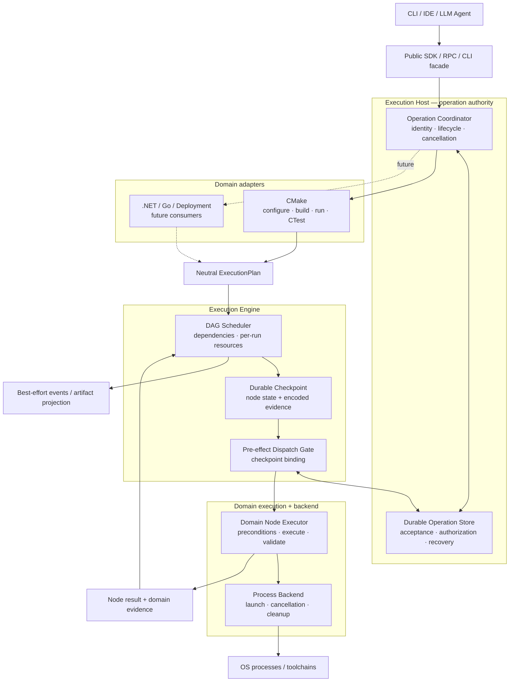
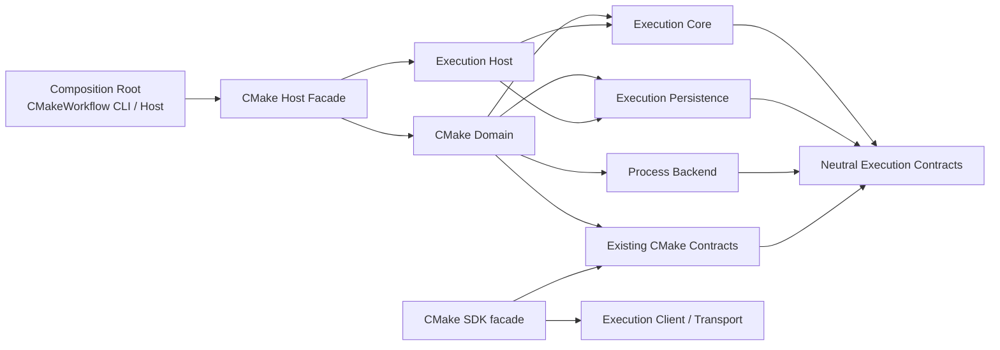
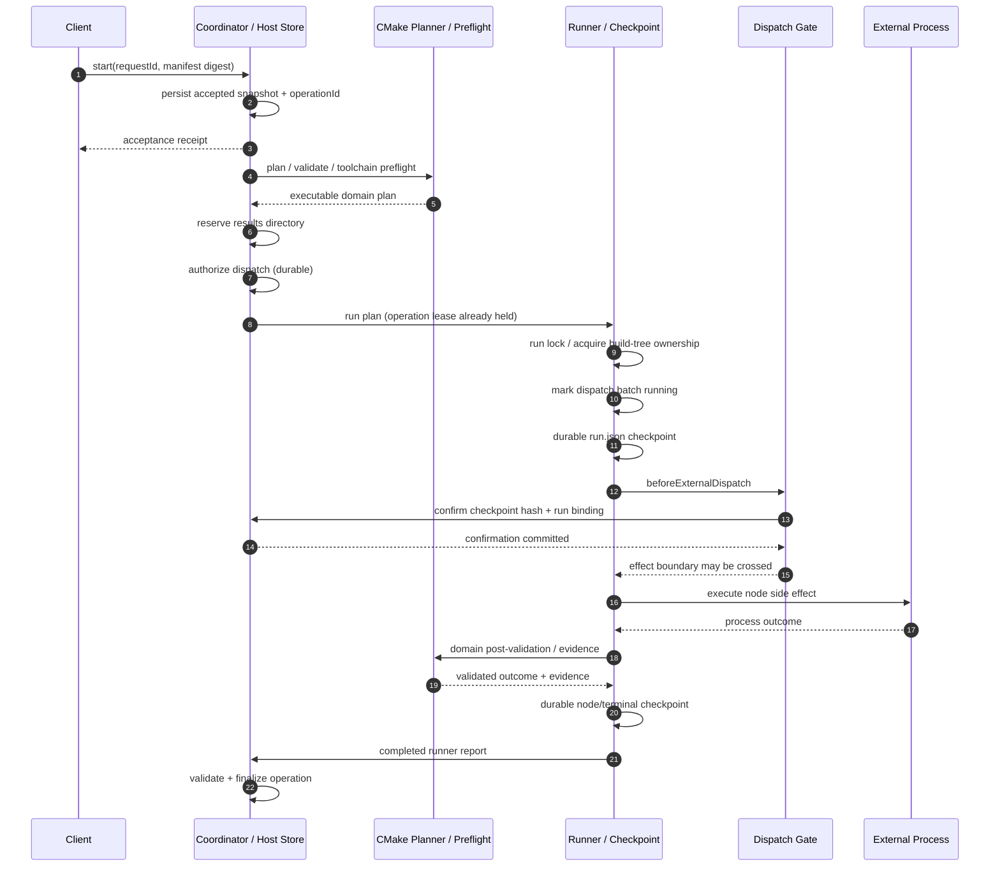
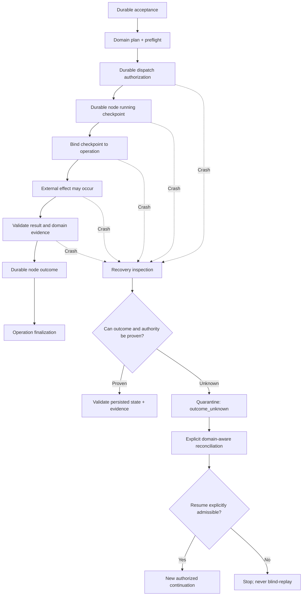

# Execution Engine Extraction — архитектура и протокол исполнения

> **Статус:** Draft / proposed architecture — **не** описание уже выполненного рефакторинга.  
> **Проект:** CMakeWorkflow (.NET 10).  
> **База аудита:** `main` @ `48a7e251eca9ec72ec68df34398d3257fb829b07`, 2026-11-05.  
> **Назначение:** единый документ для обсуждения, ADR и поэтапной работы с Codex.

## 0. Краткое решение

Выделить из CMakeWorkflow **универсальный механизм исполнения конечных workflow**, не переписывая и не ослабляя существующий CMake-контракт. CMake становится **domain adapter**: переводит пользовательские намерения в нейтральный граф, проверяет сборочное окружение, запускает действия через backend и предоставляет доказательства их результата. Engine отвечает за граф, допуск, планирование, жизненный цикл, долговечные checkpoints и фиксацию возможности внешнего эффекта. Host отвечает за устойчивую идентичность операции и её полномочия; transport/SDK — за доступ клиентов.

**Главные границы:**

1. **Operation authority ≠ DAG scheduling ≠ domain truth.** Это три различные ответственности.
2. **Нет транзакции между SQLite, `run.json` и внешним процессом.** Нет обещания exactly-once для произвольных side effects.
3. **Перед внешним эффектом — durable write-ahead + dispatch gate.** При неоднозначном исходе — fail-closed и domain-aware reconciliation, не автоматический retry.
4. **Node state и необходимое для recovery domain evidence фиксируются согласованно в одном node/run checkpoint.** Operation store привязывается к нему по идентификатору/хешу, но не коммитится атомарно с файловой системой.
5. **Миграция без смены observable semantics.** Старые manifest, `run.json`, SQLite, RPC, SDK и NativeAOT остаются рабочими.
6. **Saga/compensation — опциональный доменный workflow pattern**, а не гарантия и не основа движка.

---

## 1. Что существует сейчас, а что предлагается

### 1.1. Фактическое состояние (по read-only аудиту)

- `CMakeWorkflow.Core` сейчас содержит утилиты запуска команд и несколько operation contracts; **нейтрального DAG scheduler в нём нет**.
- В `CMakeWorkflow.CMake` находятся `WorkflowPlanner`, scheduling loop `WorkflowRunner`, build-tree ownership, CMake postchecks, `run.json` и checkpoint writer.
- В `CMakeWorkflow.Host` находятся `DurableExecutionCoordinator`, `DurableWorkflowExecutor`, `DurableAcceptanceStore`, dispatch binding, operation leases, recovery authority и Host RPC.
- В `CMakeWorkflow.Client` уже есть отдельные SDK, transport и RPC-контракты; отсутствие `ProjectReference` на Host **не устраняет wire coupling**.
- Durable Host workflow и прямой CLI workflow сейчас **различаются**: прямой CLI не проходит автоматически через Host acceptance / operation identity.
- Есть отдельные пути для ordered research commands и connection-scoped campaigns; нельзя считать их полностью эквивалентными Host durable workflow.

### 1.2. Целевая ответственность слоёв

| Слой | Владеет | **Не** владеет |
|---|---|---|
| **Client / API** | Типизированные команды, request IDs, чтение статуса, отображение прогресса | Истинностью результата, самостоятельным retry при потере ответа |
| **Execution Host / Operation Coordinator** | Operation identity, durable acceptance, authorization, cancellation intent, operation leases, reconciliation/resume authority, terminal finalization, lifetimes | Семантикой CMake target, внутренним порядком узлов DAG |
| **Execution Core** | Neutral graph, dependency closure, scheduling, per-run resource conflicts/admission, node lifecycle, dispatch sequencing | CMake File API, build tree, compiler flags, транзакцией внешнего эффекта |
| **Execution Persistence** | Атомарная запись одного checkpoint, storage primitives, связь checkpoint со статусом операции по проверяемым данным | Доказательством успешности CMake target, «глобальной транзакцией» нескольких хранилищ |
| **Domain Adapter** | Domain planning, preflight, result interpretation, evidence, recovery predicates, optional compensation | Общим scheduler, RPC transport |
| **Execution Backend** | OS process launch/cancel/timeout, streams, process-tree cleanup, platform capabilities | Решением, что `exit 0` означает «корректно собран target» |
| **History / Analytics** | Импорт и сравнение завершённых результатов | Authority для recovery и operation identity |

**Важно о capacity:** на первом этапе resource claims действуют **в рамках одного run**. Host-wide и distributed quotas — отдельная архитектурная задача; нельзя обещать их на основании существующих `jobs`/named resources.

---

## 2. Схема A — целевые компоненты и зависимости

**Как читать схему:** это логические границы, **не** обязательный список новых `.csproj`. Стрелки обозначают взаимодействия; они не означают, что нейтральный Engine имеет compile-time reference на CMake. Реальные сборочные зависимости должны идти **от domain adapter к engine**, а составление графа объектов/сервисов — через composition root.

**Особая оговорка:** `Checkpoint ↔ OpStore` не является 2PC. Между ними есть последовательные проверяемые записи/подтверждения, но нет общей атомарной транзакции.

### 2.1. Целевое направление зависимостей

Инвариант сборки: **`Execution Core`, neutral persistence, neutral Host/Client не ссылаются на `CMakeWorkflow.CMake`, `CMakeWorkflow.Profiling` и CMake domain contracts**. Обратные ссылки допустимы. Отдельный compatibility facade сохраняет существующее CLI/RPC/SDK API.

---

## 3. Схема B — execution protocol (фактический durable Host path)

Ниже **упрощён текущий наблюдаемый порядок** (по аудиту исходников) — это baseline, который рефакторинг обязан сохранить. Не все операции и CLI paths сегодня проходят его целиком.

**Порядок в текущем runner точнее, чем диаграмма:** operation lease, results reservation, run lock и build-tree locks имеют **разные сроки жизни**. Новая реализация не должна заменять их одним generic lock и не должна менять последовательность захвата/освобождения. Для конкретных detail windows ориентир — аудированный код и существующие crash tests.

### 3.1. Схема C — граница неопределённости после сбоя

Эта схема показывает **возможные исходы**, но не кодирует универсальный алгоритм восстановления: разные crash windows имеют разную доступную информацию. Даже если фактически процесс не стартовал, **authorization / checkpoint сами по себе не доказывают его отсутствия**. Resume всегда проходит существующие durable claims, quiescence и domain checks.

---

## 4. Какие сущности НЕ надо объединять

### 4.1. Operation, Node и Service

| Сущность | Назначение | Lifetime / результат |
|---|---|---|
| **Operation** | Устойчивое намерение, `requestId`/`operationId`, полномочия и общий lifecycle | Переживает reconnect в persistent Host; может требовать reconciliation |
| **Task / Node** | Конечная работа с dependencies и resource claims | `pending/running/terminal/unknown`, результат + evidence |
| **Service** *(future)* | Долгоживущая управляемая сессия: Vite, `dotnet watch`, backend | `starting/ready/degraded/restarting/stopping`; supervision, health/readiness |

`Service` **не нужно** встраивать в базовую конечную node state machine при первом extraction. Для него понадобятся отдельные зависимости **after-ready** vs **after-completion**, custody и ownership процесса, policies рестарта, stop, health и логов.

### 4.2. Независимые оси состояния

Не создавать единый `OperationState`, смешивающий всё сразу.

| State machine / authority | Пример вопросов и состояний | Отдельные revisions / tokens |
|---|---|---|
| **Operation acceptance / authorization** | Принята ли заявка? Разрешён ли dispatch? Зафиксирован ли результат? | Durable identity/digest, authorization и finalization |
| **Node execution** | Узел pending, running, succeeded, failed, canceled или `outcome_unknown`? | Run checkpoint + graph/evidence identity |
| **Cancellation intent** | Запрошена ли отмена? Завершены ли процессы? | Cancellation revision **отдельно** от recovery revision |
| **Recovery / reconciliation** | Подтверждён ли quiescence? Допустим ли one-shot resume? | Recovery decision, claim attempt, checkpoint hash |
| **Connection/session lifetime** | Погиб клиент или сам Host? Persistent это Host или private stdio? | Не равен operation cancellation token |

В частности: `cancel_requested ≠ canceled`, `authorized ≠ executed`, `exit code 0 ≠ domain success`, `event emitted ≠ checkpoint committed`.

### 4.3. Источники истины

| Артефакт | Authoritative для | Не authoritative для |
|---|---|---|
| SQLite **operation store** | Identity, accepted inputs, dispatch authorization, cancellation/recovery authority, finalization | Внутренней истинности CMake build artifact |
| `run.json` **runner checkpoint** | Node states и доменных доказательств, восстановленных из durable checkpoint | Подтверждения факта запуска процесса только из статуса `running` |
| `events.jsonl` | Best-effort progress/replay notifications | Recovery decision, exactly-once delivery, event-sourced state |
| History SQLite | Query/index/analytics | Повторного исполнения и authority для resume |
| Captured output / artifact catalog | Доступных подтверждённых результатов и проверяемых файлов | Безусловного доступа к произвольным workspace paths |

**Обобщение persistence:** Engine может определять единый checkpoint envelope и механизм его атомарной записи. Domain adapter кодирует и валидирует evidence; их согласованность обеспечивается **одним durable checkpoint write**, а не отдельными независимо коммитящимися `node-state.json` и `cmake-evidence.json`.

---

## 5. Почему это НЕ 2PC и НЕ обязательная Saga

### 5.1. Не 2PC

Нет двух транзакционных участников с `prepare`/`commit`/`abort`, способных удерживать подготовленную транзакцию. `cmake --build`, Ninja, npm, произвольный процесс и удалённый deployment **не поддерживают общий atomic commit с SQLite**.

Правильная квалификация: **durable write-ahead admission + pre-effect dispatch gate + conservative recovery**. `Store → checkpoint → gate → process` — последовательность проверяемых переходов, **не атомарная distributed transaction**.

**Запрещённое обещание:** «если SQLite commit прошёл, эффект точно произошёл» или «если эффекта нет в журнале, его точно не было».

**Запрещённая абстракция без отдельного RFC:** `ITransactionalExecutionBackend.Prepare/Commit/Rollback`, которая подразумевает транзакцию над обычным process launch.

### 5.2. Не обязательная Saga

Compensation может существовать только там, где у домена есть **осмысленная компенсирующая операция**. Пример deployment: staged release → activate → health check → *switch traffic back*. Это **новая отдельная операция с собственными побочными эффектами и возможными сбоями**, не магический rollback.

Для `cmake --build` «удалить созданные файлы» нельзя считать корректной универсальной компенсацией: build tree может быть shared/adopted и содержать прежние артефакты.

**Правило:** Engine умеет исполнить и отследить compensation node; **домен** решает, существует ли компенсация, когда она разрешена и что доказывает её успех.

### 5.3. Гарантии, которые реально стоит обещать

- Durable identity/acceptance для Host path при сохранении прежних digest/path semantics.
- Отсутствие **неявного redispatch** после неоднозначного authorization/side effect.
- Сохранение подтверждённого finished prefix и точные проверки перед resume.
- Durable checkpoint **до** side effect, подтверждённый dispatch gate.
- Явное различение `failed`, `canceled`, `outcome_unknown`, `needs_attention` и terminal result.
- Типизированные domain pre/postconditions и evidence; **никакого generic success по одному exit code**.

**Не обещать:** exactly-once external effects; атомарность across stores/processes; безусловный rollback; полную hermetic reproducibility; глобальные capacity limits; отсутствие произвольных действий у доверенного пользовательского manifest.

---

## 6. Контракты на новой границе (логические, ещё не API)

### 6.1. `Domain intent → Neutral ExecutionPlan`

Нейтральный план должен описывать **только то, что требуется scheduler**:

- `planId` / стабильная идентичность графа (проверяемая при resume).
- Стабильные `nodeId`, edges и dependency semantics.
- Selection closure; full-graph validation, включая невыбранные ветви.
- Per-run resource conflict keys, exclusivity, slots / constraints с явно указанным scope.
- Ссылку на **явно зарегистрированную domain execution binding**; без произвольной runtime reflection и implicit plugin scanning.
- Timeout/cancellation policy для конечной операции; capabilities, нужные backend.

**Не включать в neutral Core:** `BuildDirectory`, `CMakeTargetRef`, CMake presets, File API codemodel, configure evidence, profiler-specific required fields. Эти данные должны оставаться в adapter-owned domain context/binding.

### 6.2. `Node executor → validated outcome + evidence`

- Подготовка domain preconditions и canonical resource identity.
- Явный факт допуска/отказа **до** внешнего effect boundary.
- Выполнение через backend, сохранение stdout/stderr/artifacts по согласованному контракту.
- Проверка domain-specific результата **после** процесса.
- Typed/serializable evidence, необходимое для recovery; deterministic validation старого checkpoint.
- Domain-aware решение о допустимости reconciliation/resume; **никакого generic «retry всех failed/unknown»**.

Scheduler владеет выбором node и фиксацией transition; domain executor владеет смыслом действия. Backend владеет OS custody, а не domain success.

### 6.3. Host / persistence boundary

- `Accept` фиксирует immutable manifest bytes + request identity, **но не** весь workspace/toolchain snapshot.
- `Authorize` и gate сохраняют write-ahead ordering.
- `ConfirmRunnerCheckpoint` проверяет ожидаемые identity/hash/binding.
- Reconciliation/resume используют текущие independent revisions, leases и **one-shot claim**; не переинтерпретируют старые записи.
- Persistence abstraction **не** десериализует CMake report внутри neutral store; это ответственность CMake-specific validation adapter или compatibility facade.
- Существующие formats / RPC names / SDK types сохраняются через compatibility layer до отдельного versioned migration.

### 6.4. Resource ownership и scope

- Не объединять `operation lease`, `.workflow-run.lock`, canonical build-tree lease и results reservation в один абстрактный lock.
- CMake определяет conflict key для physical build tree, canonical aliases, nested-build restrictions и propagation environment.
- Engine применяет полученные conflict claims и имеет свои per-run гарантии.
- Изменять scope на Host-wide или distributed можно **только** с новым контрактом и тестами.

---

## 7. CMake остаётся специальным адаптером

CMake domain **продолжает** владеть:

- Managed/adopted build contexts, presets и toolchain preflight.
- Configure/generate barriers и File API observations.
- Exact target/configuration/artifact identity, build verification, executable hashes.
- Build-tree canonicalization, ownership/leases, nested same-tree guard и env propagation.
- Provenance policy `strict` / `allowUnverified` и uncertainty semantics.
- CMake-specific postchecks, manual success evidence и recovery predicates.
- Существующими manifest v1/v2, results/report shapes и recipe families.

**Критическая оговорка:** cooperative lease не защищает от сторонней IDE/Ninja. Даже после рефакторинга `BuildTreeOwnership` и subsequent validation нужны вместе. Нельзя превращать `Process exited 0` в доказательство корректности target.

---

## 8. Порядок рефакторинга — небольшие проверяемые изменения

| Этап | Разрез | Проверка / условие завершения |
|---|---|---|
| **0. Baseline** | Characterization fixtures существующих manifest, plan, `run.json`, event records, SQLite state и RPC | Сравнение старого/нового поведения. Сохранить проверяемые идентификаторы/digests |
| **1. Pure DAG seam** | Из `WorkflowPlanner.LoadSnapshotAsync` выделить full-graph validation, stable topological order, closure **в том же assembly** | Test cases: unknown deps, stable ordering, cycles в unselected branches, selected closure; CMake `from` превращается в edges **до** neutral phase |
| **2. Durable writer seam** | Разделить byte-level durable write и CMake report serialization без изменения bytes/schema | Crash/fault tests, gate order, Linux/Windows durability paths; не передавать user cancellation в safety commit |
| **3. Process boundary** | Process spec/result без `NodeResult`; сохранить CMake ownership propagation в adapter | Timeout, process-tree cleanup, stdout modes, Windows Job, Linux SIGINT; не объединять все runners насильно |
| **4. Domain executor seam** | Разделить scheduler loop и CMake `ExecuteAsync` / configure / post-validation | Сохранён один scheduler; CMake evidence и resources проходят прежние проверки |
| **5. Neutral Core** | Перенести проверенные graph/scheduling механизмы в CMake-free contracts/assembly | Нет ссылок Core → CMake/Profiling. Небольшой fake non-CMake finite DAG consumer подтверждает независимость *до* Host split |
| **6. Durable operation boundary** | Store/coordinator mechanics отделены от domain-specific report validation | Старые SQLite operations и one-shot claims доступны; lost reply/crash/resume/cancel не дают duplicate side effects |
| **7. Host/Client boundary** | Neutral Host/transport и CMake compatibility facade; composition через зависимости | Old RPC wire, SDK, persistent/private lifetime, real SSH, artifact boundaries, package-only NativeAOT smoke |
| **8. Second domain proof** | Минимальный конечный non-CMake workload без CMake types/side effects beyond test harness | Plan → dispatch → checkpoint → cancel/recover → result; всё через один runtime, без нового scheduler |

**Не делать:** одним PR менять scheduler, checkpoint schema, request digest, operation identity и RPC. **Не создавать** заранее восемь assemblies только ради красивой диаграммы.

### 8.1. Первый PR — узко ограниченный

**Задача:** исключительно pure DAG seam в текущем `CMakeWorkflow.CMake`.

**Разрешено:** добавить characterization tests, внутренний pure graph algorithm, adapter call из существующего planner, при необходимости test selector.

**Запрещено:** менять public `WorkflowPlan`, manifests, `WorkflowRunner`, `DurableAcceptanceStore`, checkpoint/report serialization, leases, Host, RPC и process execution.

**Definition of Done:** идентичный порядок узлов и selection closure на fixture наборах; те же ошибки validation; старые CLI integration tests проходят; отсутствие CMake-specific типов внутри pure graph algorithm.

---

## 9. Самые важные инварианты / anti-regression gates

| Инвариант | Если сломать | Минимальные проверки |
|---|---|---|
| **No side effect before durable gate** | Дублирование эффектов после crash | Inject crash между каждым commit/gate/process; считать реальные эффекты |
| **Node state + domain evidence coherent** | Ложный success или unsafe resume | Torn/corrupt/stale checkpoint/evidence, hash mismatch |
| **Unknown ≠ failed/retryable** | Автоматическое повторение неоднозначной операции | Lost reply; operation find; quiescence + explicit reconcile |
| **Cancellation intent durable** | Silent redispatch или исчезновение persistent work | Cancel до authorize, cancel во время process, persistent/private disconnect |
| **Leases сохраняют scope/order/lifetime** | Corruption и deadlocks | Alias/symlink, cross-process, nested tree, conflicting workflows |
| **CMake post-validation mandatory** | Запуск чужого/stale executable | Generation mismatch, modified artifact, different toolchain/config |
| **Process custody сохраняется** | Orphan processes и зависшие pipe readers | Windows descendant cleanup, Linux timeout/drain, stream modes |
| **Old identity / storage contract survives** | Изменятся operation IDs/recovery authority | Reopen old SQLite; manifests/digests/results reserved paths |
| **Events not recovery authority** | Потерянный хвост журнала ломает replay | Missing/truncated JSONL и checkpoint-only recovery |
| **Artifact boundary secure** | Чтение вне authorized results | Opaque IDs, no-follow anchored reads, traversal/symlink/hashes |
| **SDK/API NativeAOT compatible** | Runtime-only serialization failures | Generated serializers, wire fixtures, packaged AOT consumer |

**Пробел тестов по аудиту:** нет независимого `Execution.Core.Tests` с полностью нейтральным scheduler; он должен появиться при соответствующем split. Существование тестового файла не равно успешному прогону. Часть fault tests Linux-only / требует `RecoveryFaultInjection=true`.

---

## 10. Explicit non-goals первого extraction

1. **Не внедрять глобальный resource scheduler** или распределённые quotas. Существующий `jobs` — per-run slots, не число compiler processes.
2. **Не создавать generic transactional backend** с `Prepare/Commit/Rollback` для OS processes.
3. **Не вводить default retry или автоматический rollback** для `outcome_unknown`.
4. **Не превращать `events.jsonl` в event store** и не сливать History DB с operation DB.
5. **Не уравнивать CLI direct runner и Host durable workflow молча**: унификация меняет контракт.
6. **Не гарантировать одинаковую process cleanup semantics** у Core.CommandExecution, CMake.ProcessRunner, WorkflowProcessDispatcher, ProfileProcess и Tooling без отдельной работы.
7. **Не строить полноценный Service Supervisor**, deployment Saga, container platform, dynamic plugin loader или новый RPC protocol в рамках extraction.
8. **Не обещать sandbox** для недоверенного manifest: Host запускает инструменты с полномочиями своего пользователя.

---

## 11. После extraction: отдельно расширять платформу

### Фаза A — самостоятельный finite execution runtime

Сначала сделать второй тестовый потребитель, который вообще не ссылается на CMake. Подтвердить общие свойства без filesystem/build-tree semantics.

### Фаза B — другие domain adapters

`.NET`, Go, React, deployment, profiling и эксперименты компилируют свои намерения в нейтральный план. Их build systems остаются владельцами внутренних графов и инкрементальной сборки, а execution runtime управляет **внешними** этапами и артефактами.

### Фаза C — managed services (отдельное расширение)

`dotnet watch`, Vite, databases: readiness, health checks, dependency-after-ready, supervision, controlled stop и ownership. Не путать `service ready` с `node completed`.

### Фаза D — LLM/MCP/IDE frontend

Дать агентам **компактный типизированный интерфейс** `plan/start/status/cancel/find/events/artifacts`, а не unrestricted shell как единственный способ управления окружением. Host enforce capabilities и approval; агент не может из транспортной ошибки заключить, что действие не выполнялось. **Сначала correctness движка — потом новые UI**.

---

## 12. Открытые архитектурные решения (отдельные ADR / design gates)

- **Checkpoint envelope:** какие neutral fields обязательны, как включать типизированное domain evidence без сериализации CMake в neutral persistence; как сохранить старый `run.json` byte/schema contract?
- **Neutral binding:** как безопасно связать `nodeId` с domain executor без reflection, service locator, CMake types и несовместимости с NativeAOT?
- **Admission resource identity:** кому принадлежит canonicalization; где живут local vs per-run vs Host-wide conflict scopes?
- **Resume:** какая минимальная neutral recovery policy допустима; как сохранить Host decision и Runner node reconciliation раздельными?
- **Existing direct CLI:** останется independent non-durable входом или получит явный новый durable mode? Это **не** побочный эффект extraction.
- **Process backend:** какие общие гарантии cleanup действительно доказуемы на Linux/macOS/Windows; как фиксировать различие stdout modes?
- **Artifacts:** как отделить safe transfer от domain-specific verified catalog, не раздавая произвольный path access?
- **Wire and packaging:** где compatibility facade, как тестировать старые RPC methods, source-gen JSON metadata и NativeAOT package graph?
- **Services:** отдельный RFC для readiness/supervision и длительного custody, без размывания finite node semantics.

---

## 13. Архитектурные правила для ревью PR

> **Engine owns execution mechanics.**  
> **Host owns operation authority.**  
> **Domain owns execution meaning and recovery evidence.**  
> **Backend owns process mechanics and platform capability.**  
> **History owns analysis, not recovery.**
>
> **Execution Engine does not provide atomic commit or rollback across operation storage, domain checkpoints and external effects. Unknown external outcomes require explicit domain-aware reconciliation. Compensation is optional domain-level behavior.**

**Главный критерий успешного extraction:** CMakeWorkflow продолжает работать как прежде, а **один и тот же нейтральный scheduler и execution protocol** могут выполнить второй, полностью non-CMake finite workflow — без появления отдельного runtime, без потери write-ahead guarantees и без расширения promises сверх реально доказанных.

---

## Источники и границы подтверждения

- Приложенный read-only аудит: **«Аудит границ Execution Engine в CMakeWorkflow»**, `main` @ `48a7e251…`, 2026-11-05 (разделы 1–12); он фиксирует исходники и наличие тестов, **не запускал CI**.
- Существующий README CMakeWorkflow и его описание команд/форматов.
- Архитектурные диаграммы, non-goals и план выше — **предложение**, выведенное из аудита и обсуждения. Они **не** утверждают, что extraction уже реализован.
