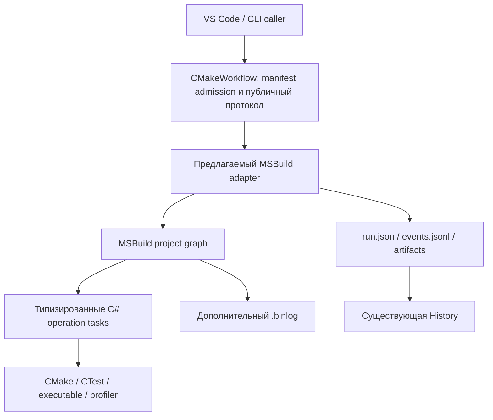

# ADR-0001: MSBuild как альтернативный движок исполнения workflow

> **Language / Язык:** [Русский](../ru/README.md) · [English](../en/adr/0001-msbuild-execution-backend.md)

- **Статус:** предложено; решение о внедрении не принято.
- **Дата:** 2026-10-29.
- **Область:** исполнение workflow, не выбор native build generator.
- **Текущая реализация:** собственный `WorkflowPlanner`/`WorkflowRunner`.
- **Реализация предложения:** отсутствует; этот ADR не добавляет команд или settings.

## Контекст

CMakeWorkflow уже выполняет DAG с ограничением `jobs`, блокировками build tree,
именованными resources, exclusive-узлами, cancellation и сохранёнными отчётами.
Операции запускают CMake/CTest, native executables и profiling backends.

По мере расширения набора операций возникает вопрос: использовать ли MSBuild
для исполнения типизированных C# tasks и графа, сохранив предметные контракты
CMakeWorkflow? MSBuild в этом варианте не должен определять C++ compiler flags
или заменять CMake backend. Tasks могли бы вызывать существующие CMakeWorkflow
операции, а MSBuild — управлять их исполнением.

Сейчас MSBuild участвует только в сборке .NET solution CLI. Выбор CMake generator
Visual Studio также сам по себе не означает реализацию данного ADR. Existing
`profile --backend` выбирает profiler и не является настройкой workflow engine.

## Цели

- Оценить возможность переиспользовать execution engine, project graph,
  logging и `.binlog` вместо развития части собственного runtime.
- Сохранить существующие manifest, CLI и IDE-контракты там, где это возможно.
- Дать предметным операциям типизированные C# task boundaries.
- Подтвердить выигрыш на реальных DAG и ограничениях нашего продукта.

Не рассматриваются перенос native dependency resolution из CMake, замена
History на binlog, изменение statistical logic или обязательная миграция
существующих пользователей.

## Предлагаемая граница

Это предполагаемая схема, не список существующих компонентов.

| MSBuild мог бы обеспечивать | CMakeWorkflow должен сохранять |
|---|---|
| Выполнение project graph и worker processes | Admission, CMake observations и provenance |
| Порядок заявленных зависимостей | Контракт ресурсов, build-tree leases и exclusive |
| Task events, logging, binlog | Стабильные node IDs, JSONL schema, authoritative run report |
| Вызов custom tasks | argv/cwd/env, executable identity и process cleanup |
| Запрос отмены tasks | Семантику canceled/blocked, финализацию partial results |

Внутри выбранного backend должен быть **один владелец планирования**.
Если адаптеру приходится держать второй scheduler, который запускает MSBuild
по одному узлу, заявленный выигрыш нужно пересмотреть. Политика ресурсов может
оставаться нашей, но способ её исполнения должен быть явно описан и проверен.

## Существенные различия семантики

### Параллелизм проектов и targets

Targets одного MSBuild project выполняются последовательно. `-m` не превращает
произвольные независимые targets одного `.proj` в параллельный DAG.
Параллелизм штатно строится вокруг projects/project instances и вызовов MSBuild
task с `BuildInParallel`; static graph опирается на project references.
[Build process](https://learn.microsoft.com/en-us/visualstudio/msbuild/build-process-overview),
[Parallel projects](https://learn.microsoft.com/en-us/visualstudio/msbuild/building-multiple-projects-in-parallel-with-msbuild).

Следовательно, прототип должен явно выбрать отображение узлов в projects или
project instances. Вариант «один manifest → один project со всеми targets»
недостаточен, если требуется сохранить текущий параллелизм. Сложность такого
отображения — часть стоимости backend, а не деталь, которую можно отложить.

### Повторные эксперименты и пропуск работы

Повторная зависимость от уже выполненного target не заставляет его выполниться
снова в том же build. `Inputs`/`Outputs` используют timestamp incrementality.
Это нельзя автоматически переносить на повторные benchmark samples и captures.
Каждый повтор должен иметь явную идентичность исполнения; недопустимы скрытые
пропуски по существованию старого отчёта.
[Target order](https://learn.microsoft.com/en-us/visualstudio/msbuild/target-build-order),
[Incremental builds](https://learn.microsoft.com/en-us/visualstudio/msbuild/incremental-builds).

Native incremental build остаётся задачей CMake. Даже если MSBuild считает свой
target актуальным, это не доказательство свежести native executable/provenance.

### Ресурсы и владение деревьями

Ограничение worker count не эквивалентно нашим ресурсам. Нужно сохранить:

- Сериализацию операций одного физического build tree, включая aliases.
- Межпроцессные leases CMakeWorkflow и защиту от небезопасного nested build.
- Конфликты именованных resources внутри workflow.
- Поведение exclusive: дождаться активных операций и выполнить узел отдельно.

Простая блокировка внутри занятого worker может расходовать worker slots и
создавать deadlock при вложенных запросах. Прототип обязан показать отсутствие
таких проблем, а не только корректный линейный сценарий.

### Tasks и процессы

Custom tasks на C# — штатный механизм MSBuild через `ITask`/`Task` и `UsingTask`.
[Custom tasks](https://learn.microsoft.com/en-us/visualstudio/msbuild/tutorial-custom-task-code-generation).

Встроенный `Exec` вызывает `cmd.exe` или `sh`. Для сохранения нашего контракта
нужны типизированные tasks с отдельными executable/argv, `UseShellExecute=false`,
обработкой stdout/stderr, timeout и cancellation.
[Exec](https://learn.microsoft.com/en-us/visualstudio/msbuild/exec-task).

`ICancelableTask.Cancel()` предоставляет callback отмены; завершение дочерних
процессов и запись результатов остаются ответственностью реализации task/adapter.
[ICancelableTask](https://learn.microsoft.com/en-us/dotnet/api/microsoft.build.framework.icancelabletask).

### Отчёты и ошибки

MSBuild events не следует напрямую объявлять нашим протоколом. Target/task
events включают внутреннюю работу engine, а skipped target не равен однозначно
нашему blocked/canceled. Нужны явное отображение идентичностей и состояния,
один writer отчёта и финализация после ошибки engine или отмены.

`.binlog` полезен как дополнительный diagnostic artifact, но не заменяет
`run.json`, event journal или History. Он может включать imports, параметры и
переменные окружения; правила публикации таких логов нужно определить отдельно.
[Binary logs](https://github.com/dotnet/msbuild/blob/main/documentation/wiki/Providing-Binary-Logs.md).

Нельзя обещать resume/retry по binlog. В текущем CMakeWorkflow event journal
также не используется для возобновления исполнения.

### Поставка и совместимость

Простой вариант прототипа — отдельный host-процесс `dotnet msbuild`. Такой путь
добавляет зависимость от установленного .NET SDK/MSBuild и managed task assemblies
даже при NativeAOT frontend. Версии host и task API необходимо фиксировать.
[dotnet msbuild](https://learn.microsoft.com/en-us/dotnet/core/tools/dotnet-msbuild).

In-process embedding — отдельное исследование: нельзя заранее обещать сохранение
нынешней поставки одним native executable. Project evaluation/imports/custom
tasks выполняют доверенный код; произвольный MSBuild project не является sandbox.

## Альтернативы

1. **Сохранить текущий runner.** Минимум миграции, прямое соответствие предметным
   состояниям и ресурсам; поддержку scheduler продолжаем нести сами.
2. **Добавить CMakeWorkflow tasks для вызова из MSBuild.** Полезно существующим
   MSBuild-проектам, но не заменяет scheduler CMakeWorkflow. Это самостоятельная
   интеграция, не доказательство состоятельности execution backend.
3. **Экспериментальный MSBuild backend.** Позволяет сравнить реализации на одном
   наборе контрактов без немедленного удаления текущего runtime.

Предлагается исследовать вариант 3 только отдельным прототипом. До оценки
результатов вариант 1 остаётся действующей архитектурой.

## Проверяемый прототип

Минимальный набор сценариев:

1. Fork/join: две независимые ветви действительно работают параллельно;
   завершающий узел ждёт обе.
2. Shared tree и его alias не исполняются конкурентно; два процесса соблюдают leases.
3. Named resource и exclusive сохраняют текущую семантику без deadlock.
4. Failed prerequisite блокирует потомка; независимая ветвь и финализация отчёта
   имеют явно согласованную с текущим runner политику.
5. Пользовательская отмена прекращает children, снимает leases и сохраняет
   canceled/partial report; при forced kill ограничения задокументированы.
6. Десять benchmark repetitions создают десять реальных samples, без reuse
   результата target или timestamp skip.
7. Пути с пробелами/Unicode и буквальные shell metacharacters передаются как argv.
8. Плагин читает прежние plan/events/report contracts; History импортирует результат.
9. Проверки на Linux, Windows и macOS с зафиксированной версией MSBuild.

Измерить startup cost, память, размер/зависимости поставки, сложность адаптера и
диагностику failures относительно текущего runner. Внедрение оправдано, если
backend сокращает поддерживаемую нами сложность без потери нужных гарантий.
Если для этого приходится заново реализовать большую часть scheduler вокруг
MSBuild, решение следует отклонить либо сузить до набора integration tasks.

## Открытые вопросы

- Как отображать workflow node в project instance и сохранять стабильный plan?
- Где исполняется admission ресурсов, не создавая второй scheduler?
- Какие MSBuild failure/skip policies совместимы с нашими independent branches?
- Как собирать events от workers в одного автора `run.json`?
- Каков допустимый deployment cost для пользователей NativeAOT CLI?
- Нужен ли пользователю MSBuild XML как public input или только внутренний adapter?

До ответов на эти вопросы ADR остаётся предложением. Ни новые CLI flags, ни
публичный backend interface этим документом не утверждаются.
