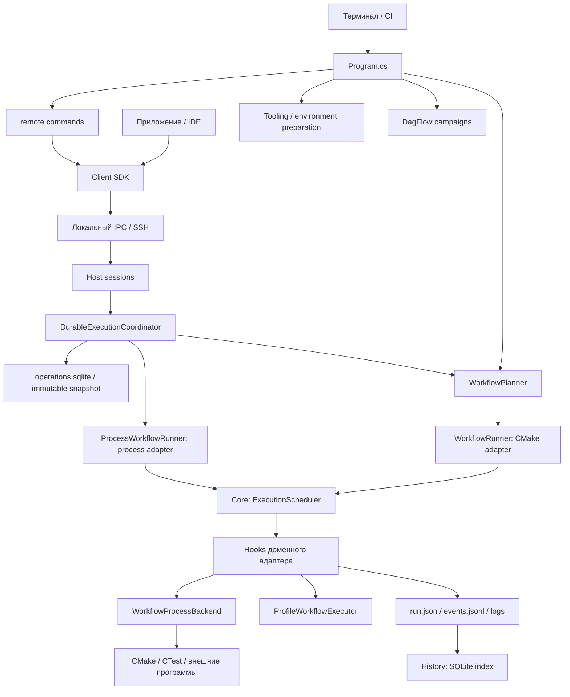

# Текущая архитектура

> **Язык / Language:** [Русский](architecture.md) · [English](en/architecture.md) · [Documentation index](README.md)

Документ описывает текущие исходники CMakeWorkflow на .NET 10. Приложение координирует внешние операции:
зависимости компиляции и инкрементальную сборку по-прежнему рассчитывают CMake и его backend. Общий execution engine
уже используется как для CMake workflow, так и для отдельного домена запуска процессов через Host.

## Компоненты

| Компонент       | Ответственность                                                                    | Основные исходники                                                                                                                                     |
|-----------------|------------------------------------------------------------------------------------|--------------------------------------------------------------------------------------------------------------------------------------------------------|
| CLI entry point | Маршрутизация команд, SIGINT, подключение profiling, автоматический импорт History | [Program.cs](../Program.cs)                                                                                                                            |
| Contracts       | Модели workflow, fluent builders и версионированные рецепты                        | [Contracts](../CMakeWorkflow.Contracts/) |
| Core            | Общий scheduler, запуск команд, hashing, контракт дополнительных операций          | [ExecutionScheduler.cs](../CMakeWorkflow.Core/Execution/ExecutionScheduler.cs), [CommandExecution.cs](../CMakeWorkflow.Core/CommandExecution.cs) |
| CMake           | File API, наблюдение build tree, provenance, leases, план и исполнение DAG         | [WorkflowDocument.cs](../CMakeWorkflow.Contracts/Workflows/WorkflowDocument.cs), [WorkflowRunner.cs](../CMakeWorkflow.CMake/Execution/WorkflowRunner.cs)                             |
| Profiling       | Платформенные captures, анализ и replay                                            | [ProfileCommand.cs](../CMakeWorkflow.Profiling/ProfileCommand.cs), [ProfileWorkflowExecutor.cs](../CMakeWorkflow.Profiling/Workflows/ProfileWorkflowExecutor.cs) |
| Campaigns       | Предметные DagFlow mutation, weak-memory и fuzz-сценарии                           | [CampaignCommand.cs](../CMakeWorkflow.Campaigns/CampaignCommand.cs)                                                                                    |
| History         | Импорт результатов в SQLite, запросы, сравнения и detection                        | [HistoryStore.cs](../CMakeWorkflow.History/Storage/HistoryStore.cs), [HistoryCommand.cs](../CMakeWorkflow.History/HistoryCommand.cs)                           |
| Tooling         | Обнаружение инструментов, план и явная установка                                   | [ToolingCommand.cs](../CMakeWorkflow.Tooling/ToolingCommand.cs)                                                                                        |
| Host            | JSON-RPC sessions, durable admission, владение операциями и доступ к результатам   | [HostServer.cs](../CMakeWorkflow.Host/Transport/HostServer.cs), [DurableExecutionCoordinator.cs](../CMakeWorkflow.Host/Workflows/DurableExecutionCoordinator.cs) |
| Client          | Типизированный SDK, локальный/SSH transport, загрузка артефактов и provisioning    | [CMakeWorkflowClient.cs](../CMakeWorkflow.Client/CMakeWorkflowClient.cs) |

Исходники сгруппированы внутри существующих проектов по назначению, без дополнительной вложенности:

- `Contracts`: модели workflow в `Workflows`, fluent API в `Builders`, контракты рецептов в `Recipes`.
- `Core/Execution`: внутренние контракты конечного графа и общий scheduler.
- `CMake`: `Build`, `Planning`, `Execution`, `Recovery`, `Artifacts`, `Reporting`, `Recipes`, `Toolchains`, `Serialization`.
- `Host` и `Client`: предметные группы `Workflows`, `Recipes`, `Profiling`, `Campaigns`, `History`, `Toolchains`,
  а также `Transport` и `Provisioning`; у Host обработчики RPC выделены в `Sessions`.
- `Host/Execution`: manifest, runner, отчёты и чтение артефактов домена `process`.
- RPC DTO и metadata находятся в `Host/Protocol` и `Client/Protocol`;
  отдельного проекта Protocol нет.
- `Profiling`: `Capture`, `Analysis`, `Backends`, `Historical`, `Replay`, `Workflows`.
- `History`: `Models`, `Storage`, `Analysis`; `Tooling`: `Tools`, `Toolchains`, `Environment`.

Командные точки входа остаются в корнях проектов; обработчики корневого CLI — в `Commands`.
Небольшие проекты сохраняют плоскую структуру. Папки не меняют пространства имён и публичный API.

Это схема ответственности, а не обещание, что каждая команда проходит через WorkflowRunner. Например, прямой
`target run` и `workflow sequence` имеют свои командные пути; они не создают автоматически такой же журнал, как
`workflow run`.

### Зависимости проектов

`Contracts` не имеет project dependencies. `Core` ссылается на `Contracts`, `CMake` — на `Core` и `Contracts`.
`Profiling` и `Campaigns` используют `Core` и `CMake`. `History` самостоятельно читает сохранённые результаты
и использует SQLite; `Tooling` реализует обнаружение и подготовку окружения.

Host собирает доменные сервисы вместе и предоставляет RPC API. Client имеет единственную project dependency —
`Contracts`; для связи он использует StreamJsonRpc и SSH.NET. В SDK нет зависимости от Host, CMake runner,
History или Tooling. Корневой executable объединяет CLI, Host и Client, в том числе для команд `remote`.

Внешняя .NET-граница, для которой CI собирает пакеты и проверяет отдельного NativeAOT-потребителя, — `Client` и
`Contracts`. Остальные сборки обеспечивают внутреннюю композицию приложения; наличие `public` само по себе не делает
их поддерживаемым API для встраивания. CLI и Host JSON-RPC имеют отдельные внешние контракты. Подробности и отдельный
inventory реализации приведены в [справочнике внешнего .NET API](public-api.md).

## Execution engine и доменные адаптеры

Общий [ExecutionScheduler](../CMakeWorkflow.Core/Execution/ExecutionScheduler.cs) работает с
`ExecutionPlan<TPayload>` и `ExecutionNode<TPayload>`: ID, prerequisites, `exclusive` и непрозрачный payload.
Он выбирает готовые узлы, ограничивает число активных задач, ждёт их завершения и распространяет состояния
зависимостей. Значение payload, конфликты ресурсов и формат сохранённого состояния определяет адаптер.

Граница проходит через [ExecutionSchedulerHooks](../CMakeWorkflow.Core/Execution/ExecutionContracts.cs):

- `GetStatus`, `Conflicts`, `MarkCanceled`, `MarkBlocked` связывают граф с доменной моделью состояния.
- `Reserve` отмечает допущенные узлы; `PersistCheckpoint` сохраняет всю выбранную партию перед её запуском.
- `ConfirmDispatch`, если задан, подтверждает durable-допуск после checkpoint и до внешних эффектов.
- `Execute` возвращает результат узла; `Complete` переносит его в общий отчёт. При выходе scheduler отменяет
  и дожидается активных задач через `DrainInFlight`, прежде чем адаптер освободит свои leases.

Scheduler не сериализует отчёты, не обращается к SQLite, не получает build-tree leases и не интерпретирует File API.
Эти контракты внутренние; публичного SDK для подключения произвольного scheduler adapter сейчас нет.

| Адаптер | Что добавляет к общему engine |
|---------|------------------------------|
| [WorkflowRunner](../CMakeWorkflow.CMake/Execution/WorkflowRunner.cs) | CMake plan, build contexts, physical tree/resource conflicts, toolchain identity, provenance, `WorkflowReport`, recovery и profiling extension |
| [ProcessWorkflowRunner](../CMakeWorkflow.Host/Execution/ProcessWorkflowRunner.cs) | Отдельный manifest `domain: process`, executable/arguments/cwd/environment, DAG, named resources, exclusive, timeout и собственный `ProcessOperationReport` |

Process-домен доступен через `execution/start` и `Client.Executions.StartAsync`; значение `cmake` в этом же API
направляется в существующий CMake-путь. Совместимый `workflow/start` сохранён. Process-домен не использует
CMake contexts, targets или CMake report: его manifest и `run.json` имеют собственную схему. Его восстановление
через resume поддерживается только явно, после SQLite reconciliation и проверки доказательств отсутствия
предыдущего допуска для исполняемых узлов. `running`/`outcome_unknown` блокируют продолжение;
успешные и другие терминальные узлы не повторяются. Одноразовый claim сохраняется до изменения runner state.
Подробнее — [process recovery](ru/process-execution.md).

Общие примитивы находятся в Core: scheduler — в `Execution`,
[WorkflowProcessBackend](../CMakeWorkflow.Core/Processes/WorkflowProcessBackend.cs) — в `Processes`,
[DurableByteWriter](../CMakeWorkflow.Core/Persistence/DurableByteWriter.cs) — в `Persistence`.
CMake и Host получают доступ к внутренним типам через `InternalsVisibleTo`.
`CMakeProcessExecution` остаётся адаптером подготовки CMake-процесса.

## Выполнение workflow

1. Planner десериализует manifest, проверяет идентификаторы, виды узлов и весь граф на циклы. Структурная проверка
   включает и невыбранные ветви.
2. Повторяемый `--only` выбирает узлы вместе с транзитивными prerequisites.
3. Planner наблюдает build trees и формирует diagnostics. Проверки после явного configure-предка могут быть отложены до
   runtime.
4. При известных ошибках preflight запуск отклоняется до выполнения операций.
5. Runner создаёт каталог результата и начальный отчёт, получает leases для build trees, над которыми планируются
   операции кроме `inspect`.
6. `WorkflowRunner` передаёт граф общему scheduler. Перед внешним запуском hooks отмечают выбранные узлы `running`,
   сохраняют checkpoint и, при запуске из Host, подтверждают dispatch. Общий отчёт изменяется последовательно
   через hooks адаптера; выполняющаяся операция возвращает свой `NodeResult`.
7. Состояние сохраняется по ходу работы и после завершения. Entry point затем пытается индексировать сохранённые
   результаты, если History не отключён.

Рецепты benchmark, profile и matrices преобразуются в обычный CMake workflow. Подготовка рецепта и preflight
отделены от запуска; полученный manifest проходит тот же planner и runner. Подробнее —
[типизированные рецепты](ru/recipes.md).

### Запуск и сопровождение процессов

[CMakeWorkflowNodeExecutor](../CMakeWorkflow.CMake/Execution/CMakeWorkflowNodeExecutor.cs) интерпретирует вид CMake-узла
и готовит операцию. `WorkflowProcessDispatcher` сохраняет совместимую точку входа, а
`CMakeProcessExecution` формирует `ProcessStartInfo`, environment, CPU-affinity launcher, передачу build-tree ownership
и пути stdout/stderr. Затем нейтральный `WorkflowProcessBackend` запускает процесс, параллельно читает оба потока,
ожидает завершения и выполняет cleanup при отмене или ошибке. На Windows используется Job Object.
Process-адаптер готовит собственный `ProcessStartInfo` и использует тот же backend напрямую.

`WorkflowCommandDispatcher` обслуживает упорядоченные серии внешних команд с журналом `commands.json`.
Порядок задаёт вызывающий доменный код; dispatcher сохраняет намерение до запуска и проверяет идентичность
команд и сохранённых outputs при допустимом продолжении.

## Host, SDK и transport

Host обслуживает JSON-RPC через StreamJsonRpc с header-delimited framing. Локальный transport — Unix-domain socket
либо Windows named pipe текущего пользователя. `DoctorSession` реализован partial-классом в `Sessions`;
после `initialize` сессия привязана к workspace. `WorkspaceReadPaths` проверяет разрешённые пути и выход через symlink.

Постоянный `host serve --endpoint` владеет общим `DurableExecutionCoordinator`, а соединения — отдельными sessions.
Короткие RPC привязаны к соединению; принятые durable-операции живут под управлением координатора и токена Host.
Закрытие клиента не отправляет отмену принятой операции. Для отмены существует отдельный `operations/cancel`.

| Способ подключения | Владение Host |
|-------------------|---------------|
| `ConnectAsync` | Подключение к существующему локальному Host; отключение закрывает соединение |
| `ConnectSshAsync` / `ConnectSshNetAsync` | OpenSSH либо SSH.NET запускает `host bridge --stdio --endpoint`; мост передаёт байты существующему удалённому Host |
| `LaunchAsync` | SDK запускает частный локальный Host и останавливает его при освобождении клиента |
| `LaunchSshNetAsync` | Частный удалённый `host serve --stdio` в SSH.NET exec channel; закрытие клиента завершает этот Host и незавершённую работу |

SSH сохраняет тот же RPC-протокол. Manifest, workspace, toolchain, build trees и результаты принадлежат удалённой
машине; автоматической синхронизации исходников нет. SDK предоставляет чтение отчётов и порционную загрузку
артефактов по ID с проверкой metadata и SHA-256. `Provisioning` и CLI `remote provision` отдельно обеспечивают
явную подготовку удалённого Host; обычное подключение не выполняет provisioning.

Host и SDK используют закрытые DTO, source-generated `System.Text.Json` metadata (`HostJson`, `ClientJson`)
и generated RPC contracts. Корневой CLI настроен на NativeAOT, Client — на AOT compatibility;
отдельный `CMakeWorkflow.Client.AotSmoke` проверяет сценарий потребителя SDK.

## Durable-операции и восстановление

Host хранит admission в `<workspace>/.cmakeworkflow/operations.sqlite` через
[DurableAcceptanceStore](../CMakeWorkflow.Host/Workflows/DurableAcceptanceStore.cs). Запись включает идентичность
запроса, неизменяемый snapshot manifest, допуск dispatch и сведения о checkpoint.
Для process домена сохраняются также точные байты последнего dispatch checkpoint: аудит resume связывается
с их hash при существующем `ClaimResumeAttempt`. Отдельного recovery store нет. Повтор исходного запроса с тем же
`ClientRequestId` возвращает ту же операцию; изменение параметров с тем же ID отклоняется.

Порядок запуска: принять snapshot и проверить hash → проверить доменный plan → зарезервировать results directory →
зафиксировать разрешение dispatch → сохранить runner checkpoint → связать его точные байты с операцией →
выполнить внешнюю работу. Координатор владеет временем жизни, а доменный executor — интерпретацией запроса и запуском
runner. `IOperationCheckpointEvidenceCodec` проверяет доменный checkpoint для dispatch, resume и finalization;
store связывает подтверждённые данные с операцией транзакционно.

RPC-ответ может потеряться после принятия запроса. Для восстановления связи клиент ищет операцию по прежнему
request ID, читает состояние и страницы событий. Автоматического повтора start с новым ID нет.
`operations/cancel` сохраняет намерение отмены с проверкой revision; receipt ещё не означает завершение процесса.

Checkpoint исполнения CMake — `run.json`. Перед запуском партии узлов runner фиксирует `running`, поэтому после
аварии запись не доказывает ни факт запуска, ни отсутствие внешних эффектов. Неопределённый результат получает
`outcome_unknown`; автоматический повтор запрещён. Reconcile сохраняет явное решение оператора и аудит,
проверяя hash checkpoint или revision Host. Продолжение требует отдельного resume и повторной проверки manifest,
артефактов, build-tree observations и toolchain identity. Подробнее — [Recovery](recovery.md).

`DurableByteWriter` записывает временный файл, выполняет flush, атомарную замену и платформенную синхронизацию
каталога. Run lease защищает запись отчёта, operation lease — выполнение принятой операции, build-tree leases —
участвующие CMake trees. У каждого уровня своя область владения.

### Состояние и результаты

| Хранилище | Назначение |
|-----------|------------|
| Manifest и accepted snapshot | Запрошенный граф и неизменяемый вход принятой Host-операции |
| `operations.sqlite` | Durable admission, request identity, dispatch/recovery/cancellation metadata Host |
| `<run>/run.json` | Авторитетный доменный checkpoint и отчёт исполнения |
| `<run>/events.jsonl` | Уведомления с sequence для live progress и постраничного replay; не источник восстановления исполнения |
| Логи и артефакты run | stdout/stderr, captures, snapshots и доказательства результатов |
| History SQLite | Перестраиваемый индекс завершённых результатов для запросов, сравнения и detection |
| `<build>/cmake-workflow/` | Configure provenance и данные CMake bridge |

Одинаковое имя `run.json` не делает отчёты CMake и process взаимозаменяемыми. Для process предусмотрено
`execution/report`, для CMake — `operations/report`; чтение и каталог артефактов учитывают домен операции.
History не участвует в scheduler или разрешении dispatch. Ошибка автоматического импорта CLI не меняет exit status
workflow; исходные результаты остаются доступными. Operation store и History — разные базы с разным назначением.

## Ограничения параллелизма

`--jobs` ограничивает число одновременно активных workflow-узлов; это не флаг параллелизма внутреннего native build
backend.

В CMake workflow два узла конфликтуют, если имеют один физический build tree, общий именованный
`resources` или хотя бы один из них `exclusive`. Когда exclusive-узел готов, runner дожидается завершения уже активной
работы перед его запуском. Именованные resources относятся к данному workflow; они не являются глобальным сервисом
блокировок между независимыми процессами.

В process workflow scheduler применяет `resources` и `exclusive`; build-tree coordination к этому домену не относится.

Leases build tree координируют участвующие CMakeWorkflow-процессы. Обычный запуск Ninja, CMake или IDE не обязан
соблюдать эти leases. Runner не гарантирует изоляцию от внешнего изменения дерева.

Ошибка prerequisite блокирует зависящие узлы. Независимые ветви могут продолжать работу. Отмена отмечается явно; не
запущенные узлы получают `canceled`, а итог workflow при пользовательской отмене — `canceled`, exit code 130.

## Границы достоверности

Наличие executable не доказывает актуальность target. Каждый build-запрос доходит до CMake/backend; CMakeWorkflow не
реализует собственный анализ native dependencies или ответ `IsTargetUpToDate`.

Provenance фиксирует наблюдения и configure-вызовы. Она не доказывает полную герметичность окружения, отсутствие
изменений от IDE или отсутствие фоновой нагрузки во время benchmark. Изменение File API generation может понизить
доверие к происхождению даже при совпадении некоторых свойств cache.

## Расширение

`IWorkflowOperationExecutor` принимает executable, массив аргументов, cwd, environment, options, каталог результата и
node ID; возвращает exit code, status и outputs. Сейчас через него подключён `profile`.

Это внутренний контракт операций, а не система динамической загрузки сторонних плагинов. Допустимые `kind` перечислены в
planner явно: одной реализации интерфейса недостаточно, чтобы добавить новый вид узла в manifest.

Сейчас `WorkflowRunner` — CMake-адаптер общего `ExecutionScheduler`, а `ProcessWorkflowRunner` — второй потребитель
того же engine. Добавление домена требует явной регистрации в
[HostOperationComposition](../CMakeWorkflow.Host/Workflows/HostOperationComposition.cs), адаптера исполнения,
проверки checkpoint evidence и соответствующих API чтения результатов. Динамической загрузки доменов нет.

MSBuild используется обычным образом при сборке .NET solution, но не исполняет пользовательские workflow.
Альтернативный execution backend обсуждается только в
[ADR-0001](adr/0001-msbuild-execution-backend.md).
