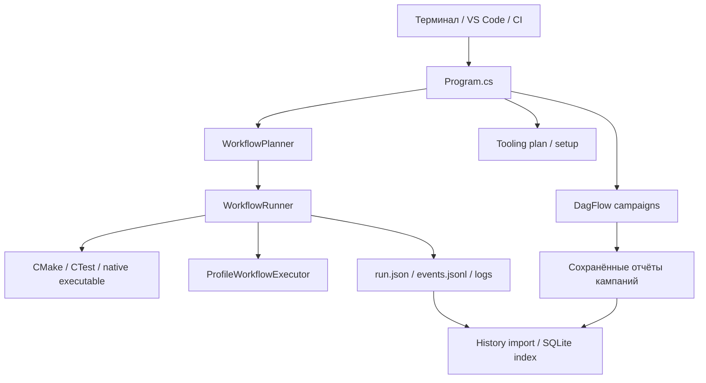

# Текущая архитектура

## Компоненты

| Компонент | Ответственность | Основные исходники |
|---|---|---|
| CLI entry point | Маршрутизация команд, SIGINT, подключение profiling, автоматический импорт History | [Program.cs](../Program.cs) |
| Core | Запуск процессов, hashing, контракт дополнительных операций | [CommandExecution.cs](../CMakeWorkflow.Core/CommandExecution.cs), [WorkflowOperation.cs](../CMakeWorkflow.Core/WorkflowOperation.cs) |
| CMake | File API, наблюдение build tree, provenance, leases, план и исполнение DAG | [WorkflowModel.cs](../CMakeWorkflow.CMake/WorkflowModel.cs), [WorkflowRunner.cs](../CMakeWorkflow.CMake/WorkflowRunner.cs) |
| Profiling | Платформенные captures, анализ и replay | [ProfileCommand.cs](../CMakeWorkflow.Profiling/ProfileCommand.cs), [ProfileWorkflowExecutor.cs](../CMakeWorkflow.Profiling/ProfileWorkflowExecutor.cs) |
| Campaigns | Предметные DagFlow mutation, weak-memory и fuzz-сценарии | [CampaignCommand.cs](../CMakeWorkflow.Campaigns/CampaignCommand.cs) |
| History | Импорт результатов в SQLite, запросы, сравнения и detection | [HistoryStore.cs](../CMakeWorkflow.History/HistoryStore.cs), [HistoryCommand.cs](../CMakeWorkflow.History/HistoryCommand.cs) |
| Tooling | Обнаружение инструментов, план и явная установка | [ToolingCommand.cs](../CMakeWorkflow.Tooling/ToolingCommand.cs) |

Это схема ответственности, а не обещание, что каждая команда проходит через
WorkflowRunner. Например, прямой `target run` и `workflow sequence` имеют свои
командные пути; они не создают автоматически такой же журнал, как `workflow run`.

## Выполнение workflow

1. Planner десериализует manifest, проверяет идентификаторы, виды узлов и весь
   граф на циклы. Структурная проверка включает и невыбранные ветви.
2. Повторяемый `--only` выбирает узлы вместе с транзитивными prerequisites.
3. Planner наблюдает build trees и формирует diagnostics. Проверки после явного
   configure-предка могут быть отложены до runtime.
4. При известных ошибках preflight запуск отклоняется до выполнения операций.
5. Runner создаёт каталог результата и начальный отчёт, получает leases для
   build trees, над которыми планируются операции кроме `inspect`.
6. Готовые узлы выполняются с учётом `--jobs`, зависимостей и конфликтов ресурсов.
   Только scheduler обновляет общую модель отчёта; выполняющаяся операция
   возвращает свой `NodeResult`.
7. Состояние сохраняется по ходу работы и после завершения. Entry point затем
   пытается индексировать сохранённые результаты, если History не отключён.

## Ограничения параллелизма

`--jobs` ограничивает число одновременно активных workflow-узлов; это не флаг
параллелизма внутреннего native build backend.

Два узла конфликтуют, если имеют один физический build tree, общий именованный
`resources` или хотя бы один из них `exclusive`. Когда exclusive-узел готов,
runner дожидается завершения уже активной работы перед его запуском. Именованные
resources относятся к данному workflow; они не являются глобальным сервисом
блокировок между независимыми процессами.

Leases build tree координируют участвующие CMakeWorkflow-процессы. Обычный запуск
Ninja, CMake или IDE не обязан соблюдать эти leases. Runner не гарантирует
изоляцию от внешнего изменения дерева.

Ошибка prerequisite блокирует зависящие узлы. Независимые ветви могут продолжать
работу. Отмена отмечается явно; не запущенные узлы получают `canceled`, а итог
workflow при пользовательской отмене — `canceled`, exit code 130.

## Границы достоверности

Наличие executable не доказывает актуальность target. Каждый build-запрос
доходит до CMake/backend; CMakeWorkflow не реализует собственный анализ native
dependencies или ответ `IsTargetUpToDate`.

Provenance фиксирует наблюдения и configure-вызовы. Она не доказывает полную
герметичность окружения, отсутствие изменений от IDE или отсутствие фоновой
нагрузки во время benchmark. Изменение File API generation может понизить
доверие к происхождению даже при совпадении некоторых свойств cache.

## Расширение

`IWorkflowOperationExecutor` принимает executable, массив аргументов, cwd,
environment, options, каталог результата и node ID; возвращает exit code,
status и outputs. Сейчас через него подключён `profile`.

Это внутренний контракт операций, а не система динамической загрузки сторонних
плагинов. Допустимые `kind` перечислены в planner явно: одной реализации
интерфейса недостаточно, чтобы добавить новый вид узла в manifest.

Текущий scheduler — собственный `WorkflowRunner`. MSBuild используется обычным
образом при сборке .NET solution, но не исполняет пользовательские workflow.
Альтернативный execution backend обсуждается только в
[ADR-0001](adr/0001-msbuild-execution-backend.md).
