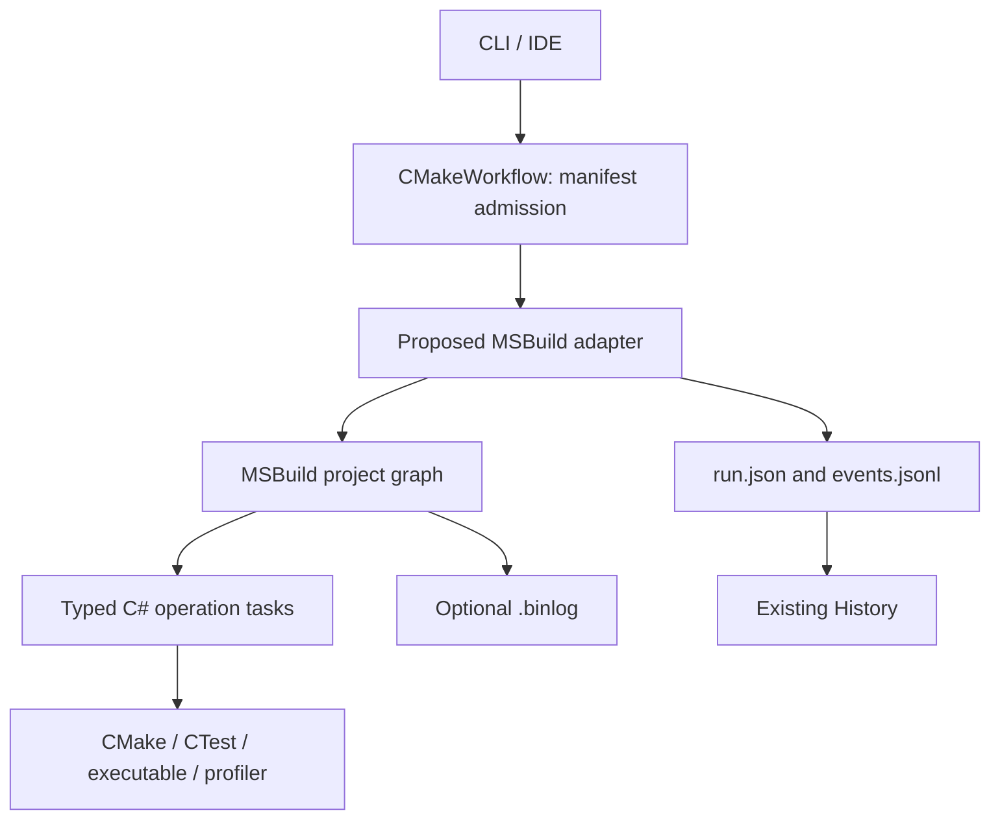

# ADR-0001: Proposed MSBuild workflow execution backend

**[English](0001-msbuild-execution-backend.md) · [Русский](../../adr/0001-msbuild-execution-backend.md) · [Index](../README.md)**

- **Status:** proposed; **not implemented**.
- **Date:** 2026-10-29.
- **Scope:** workflow execution only, **not** replacement of CMake or its native build generator.
- **Current engine:** CMakeWorkflow's own `WorkflowPlanner` / `WorkflowRunner`.

## Context and goal

The existing runtime provides a DAG, job limits, build-tree leases, named resources, exclusive nodes, cancellation, report persistence and profile/campaign operations. The proposal considers reusing **MSBuild's execution engine** and typed C# tasks for this graph while retaining CMake for C++ compilation. Possible benefits include scheduling infrastructure, logging and `.binlog`; benefits must be demonstrated rather than assumed.

Existing public manifests, CLI, IDE and saved report contracts should remain stable. MSBuild must **not** become a new source of compiler flags, CMake preset resolution, build-tree freshness, History identity or regression semantics. Merely selecting a Visual Studio CMake generator does not implement this ADR.

## Proposed responsibility split

MSBuild could supply graph/project execution, task boundaries and logging. CMakeWorkflow must continue to own application semantics: explicit admission, provenance, physical tree ownership, result identity, cancellation cleanup and authoritative reports. A design requiring two schedulers, where the adapter launches MSBuild once per node, undermines the reason for adopting it.

## Critical semantic differences

### Parallel graph execution

MSBuild targets in **one project** execute sequentially. `-m` does not magically parallelize independent targets in a single `.proj`; parallelism concerns projects/project instances and `MSBuild` task invocation with `BuildInParallel`. Static graph execution relies on project references. The prototype must therefore map workflow nodes to projects or project instances, preserving dependency closure, `--jobs`, exclusive constraints and shared tree locks.

### Repeated experiments and incrementality

MSBuild may skip a target already built in the same invocation; Inputs/Outputs timestamps also support incremental skipping. Repeated benchmark samples and diagnostic captures are **side effects requiring unique executions**, not targets whose presence implies freshness. Each repetition must have explicit identity, and existing run directories cannot prove a sample should be skipped. Native incremental compilation still belongs to CMake.

### Resource coordination and external effects

A worker count is not equivalent to the existing build-tree leases, same-physical-path alias detection, named resources and `exclusive`. Tasks also need to preserve argv/cwd/env exactly, cancel and await descendant processes correctly, and distinguish timeout, cancellation and failed cleanup. A Job Object or other process-tree primitive cannot be replaced by an MSBuild exit code.

### Events, recovery and compatibility

Optional `.binlog` does not replace `run.json` or event schemas. Existing clients need stable node IDs, statuses, errors, actual artifact paths and compatible post-crash behavior. Integration with MSBuild task events must not create false success after a canceled/unknown external effect. New packaging/runtime dependencies and cross-platform AOT behavior are part of the prototype's cost.

## Options and decision gate

Alternatives are to keep the current runner; implement a narrow optional adapter; or replace execution only after a measured, semantically equivalent prototype. The benchmark is not just scheduling overhead. The prototype should prove equivalence under parallel independent nodes, two build trees, repeated experiments, cancellation with descendants, external resource conflicts and partial failure/recovery. Compare code complexity, behavioral risk, logs, throughput, API ergonomics and packaging.

**No migration decision has been made.** CMakeWorkflow continues to execute manifests using `WorkflowRunner`; this page records a design exploration, not a feature or CLI option.

References: [MSBuild build process](https://learn.microsoft.com/en-us/visualstudio/msbuild/build-process-overview), [parallel projects](https://learn.microsoft.com/en-us/visualstudio/msbuild/building-multiple-projects-in-parallel-with-msbuild), [target order](https://learn.microsoft.com/en-us/visualstudio/msbuild/target-build-order), [incremental builds](https://learn.microsoft.com/en-us/visualstudio/msbuild/incremental-builds).
