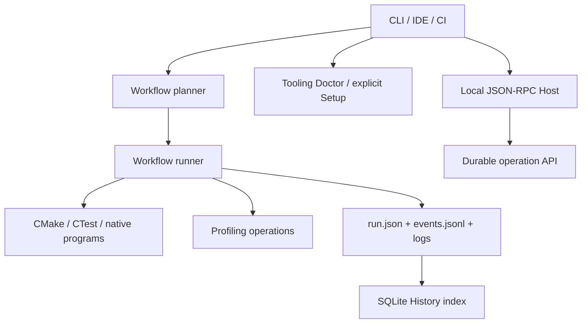

# Architecture

**[English](architecture.md) · [Русский](../architecture.md) · [Index](README.md)**

CMakeWorkflow orchestrates **external work**. It does not replace CMake's dependency graph, its generator or a C++ compiler. The boundaries matter both for correctness and for interpreting saved benchmark evidence.

## Components

| Component | Responsibility | Implementation |
|---|---|---|
| CLI | Command dispatch, Ctrl+C/SIGINT, history indexing | [Program.cs](../../Program.cs) |
| Core | Child-process execution, cancellation, hashing and operation contracts | [Core](../../CMakeWorkflow.Core/) |
| CMake | CMake File API, contexts, provenance, leases, DAG planning and execution | [WorkflowRunner.cs](../../CMakeWorkflow.CMake/WorkflowRunner.cs) |
| Profiling | Platform capture, analysis and replay | [ProfileWorkflowExecutor.cs](../../CMakeWorkflow.Profiling/ProfileWorkflowExecutor.cs) |
| Campaigns | Optional DagFlow mutation, weak-memory and fuzz workflows | [CampaignCommand.cs](../../CMakeWorkflow.Campaigns/CampaignCommand.cs) |
| History | SQLite indexing, queries, descriptive comparison and statistical tests | [HistoryStore.cs](../../CMakeWorkflow.History/HistoryStore.cs) |
| Tooling | Read-only discovery/planning and explicit tool installation | [ToolingCommand.cs](../../CMakeWorkflow.Tooling/ToolingCommand.cs) |
| Host/SDK | Local JSON-RPC session and typed NativeAOT-compatible clients | [Host](../../CMakeWorkflow.Host/), [Client](../../CMakeWorkflow.Client/) |

This is a responsibility map, **not** a guarantee that every command invokes `WorkflowRunner`: direct target commands and `workflow sequence` have separate execution paths and are not equivalent to journaled `workflow run` operations.

## Workflow lifecycle

1. Deserialize the manifest, validate every node and reject structurally invalid graphs, even in unselected branches.
2. Apply repeatable `--only` filters **with transitive prerequisites**.
3. Observe CMake build trees and prepare diagnostics. Checks dependent on an explicit configure node may be deferred until execution.
4. Reject known preflight conflicts before dispatching external work.
5. Create the run directory and initial report, and acquire leases for participating build trees (other than inspect-only operations).
6. Dispatch ready nodes subject to dependency, resource, exclusive and build-tree constraints; the scheduler alone updates shared report state.
7. Persist checkpoints during execution and on termination. The CLI attempts History indexing afterwards unless disabled; indexing failures do not rewrite the workflow result.

## Concurrency and ownership

`--jobs` limits **workflow nodes**, not Ninja or compiler worker count. Concurrent nodes conflict when they use the same canonical physical build tree, share a named `resources` entry, or one requests `exclusive`. An exclusive node waits until already-running work finishes. Named resources apply **within a workflow**; they are not distributed semaphores.

Build-tree leases coordinate other **CMakeWorkflow** instances. An IDE, standalone Ninja or another CMake invocation can still modify the tree. Do not interpret a lease as a filesystem sandbox or a global build lock. Failed prerequisites block dependent nodes; independent branches may continue. User cancellation marks unstarted nodes canceled and uses workflow exit code 130.

## Provenance is evidence, not a proof

A present executable is not proof that it matches current sources. Native build requests are delegated to CMake. A configure invocation and File API observations establish a limited, inspectable chain of evidence, **not** a hermetic build. A File API generation change may downgrade provenance even when observed properties look unchanged. Timing comparisons cannot guarantee equal CPU temperature, frequencies or background load merely because saved fingerprints match.

`IWorkflowOperationExecutor` is an internal operation interface used for profiling. It is **not** a third-party plugin loader: manifest node kinds must also be registered in the planner. The existing scheduler is `WorkflowRunner`; [MSBuild as an alternative executor](adr/0001-msbuild-execution-backend.md) remains a proposal only.
