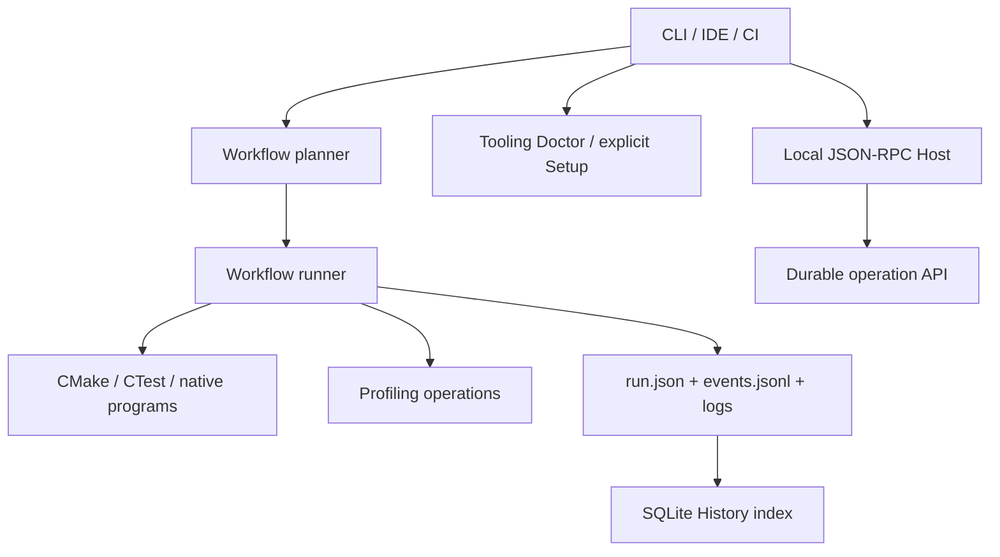

# Architecture

**[English](architecture.md) · [Русский](../architecture.md) · [Index](README.md)**

CMakeWorkflow orchestrates **external work**. It does not replace CMake's dependency graph, its generator or a C++
compiler. The boundaries matter both for correctness and for interpreting saved benchmark evidence.

## Components

| Component | Responsibility                                                           | Implementation                                                                         |
|-----------|--------------------------------------------------------------------------|----------------------------------------------------------------------------------------|
| CLI       | Process entry, Ctrl+C/SIGINT and command routing                         | [Program.cs](../../Program.cs), [CLI routing](../../Commands/CliApplication.cs)          |
| Core      | Child-process execution, cancellation, hashing and operation contracts   | [Core](../../CMakeWorkflow.Core/)                                                      |
| CMake     | CMake File API, contexts, provenance, leases, DAG planning and execution | [WorkflowRunner.cs](../../CMakeWorkflow.CMake/Execution/WorkflowRunner.cs)                       |
| Profiling | Platform capture, analysis and replay                                    | [ProfileWorkflowExecutor.cs](../../CMakeWorkflow.Profiling/Workflows/ProfileWorkflowExecutor.cs) |
| Campaigns | Optional DagFlow mutation, weak-memory and fuzz workflows                | [CampaignCommand.cs](../../CMakeWorkflow.Campaigns/CampaignCommand.cs)                 |
| History   | SQLite indexing, queries, descriptive comparison and statistical tests   | [HistoryStore.cs](../../CMakeWorkflow.History/Storage/HistoryStore.cs)                         |
| Tooling   | Read-only discovery/planning and explicit tool installation              | [ToolingCommand.cs](../../CMakeWorkflow.Tooling/ToolingCommand.cs)                     |
| Host/SDK  | Local JSON-RPC session and typed NativeAOT-compatible clients            | [Host](../../CMakeWorkflow.Host/), [Client](../../CMakeWorkflow.Client/)               |

Sources are grouped by responsibility within the existing projects, with one level of folders:

- `Contracts`: workflow models in `Workflows`, the fluent API in `Builders`, recipe contracts in `Recipes`.
- `CMake`: `Build`, `Planning`, `Execution`, `Recovery`, `Artifacts`, `Reporting`, `Recipes`, `Toolchains`, `Serialization`.
- `Host` and `Client`: feature groups `Workflows`, `Recipes`, `Profiling`, `Campaigns`, `History`, `Toolchains`; Host also has `Sessions`, `Transport` and `Provisioning`, with shared RPC contracts in `Protocol`.
- `Profiling`: `Capture`, `Analysis`, `Backends`, `Historical`, `Replay`, `Workflows`.
- `History`: `Models`, `Storage`, `Analysis`; `Tooling`: `Tools`, `Toolchains`, `Environment`.

Command entry points stay at project roots; root CLI handlers live in `Commands`.
Small projects remain flat. Source declarations define CLR namespaces; folder layout and public visibility alone do
not establish an external compatibility contract. The external .NET SDK package boundary consists of Client and
Contracts; see [External .NET API](../public-api.md) for its scope and the separate implementation inventory.

This is a responsibility map, **not** a guarantee that every command invokes `WorkflowRunner`: direct target commands
and `workflow sequence` have separate execution paths and are not equivalent to journaled `workflow run` operations.

## Workflow lifecycle

1. Deserialize the manifest, validate every node and reject structurally invalid graphs, even in unselected branches.
2. Apply repeatable `--only` filters **with transitive prerequisites**.
3. Observe CMake build trees and prepare diagnostics. Checks dependent on an explicit configure node may be deferred
   until execution.
4. Reject known preflight conflicts before dispatching external work.
5. Create the run directory and initial report, and acquire leases for participating build trees (other than
   inspect-only operations).
6. Dispatch ready nodes subject to dependency, resource, exclusive and build-tree constraints; the scheduler alone
   updates shared report state.
7. Persist checkpoints during execution and on termination. The CLI attempts History indexing afterwards unless
   disabled; indexing failures do not rewrite the workflow result.

## Concurrency and ownership

`--jobs` limits **workflow nodes**, not Ninja or compiler worker count. Concurrent nodes conflict when they use the same
canonical physical build tree, share a named `resources` entry, or one requests `exclusive`. An exclusive node waits
until already-running work finishes. Named resources apply **within a workflow**; they are not distributed semaphores.

Build-tree leases coordinate other **CMakeWorkflow** instances. An IDE, standalone Ninja or another CMake invocation can
still modify the tree. Do not interpret a lease as a filesystem sandbox or a global build lock. Failed prerequisites
block dependent nodes; independent branches may continue. User cancellation marks unstarted nodes canceled and uses
workflow exit code 130.

## Provenance is evidence, not a proof

A present executable is not proof that it matches current sources. Native build requests are delegated to CMake. A
configure invocation and File API observations establish a limited, inspectable chain of evidence, **not** a hermetic
build. A File API generation change may downgrade provenance even when observed properties look unchanged. Timing
comparisons cannot guarantee equal CPU temperature, frequencies or background load merely because saved fingerprints
match.

`IWorkflowOperationExecutor` is a public CLR type used as an internal cross-assembly operation contract for profiling.
It is **not** a third-party plugin loader: manifest node kinds must also be registered in the planner. The neutral
`ExecutionScheduler` in Core manages ready/active admission through domain hooks.
`WorkflowRunner` is the CMake adapter; `ProcessWorkflowRunner` is a second actual consumer in Host.
The shared process backend and durable byte writer also live in Core. Domain adapters own report schemas,
leases, resource identity and dispatch evidence; the scheduler does not interpret or persist their reports.

Process operations use the existing SQLite reconciliation/admission/one-shot resume claim protocol.
Explicit resume preserves terminal results and runs only nodes proven never admitted by the bound dispatch
checkpoint. Running or unknown results block resume, even after an operation-level `needs_attention` decision.
The claim precedes runner mutation; a post-claim crash cannot redispatch. Legacy reports remain readable,
but operations without retained dispatch evidence cannot be newly admitted for process resume.
See [process execution and recovery](process-execution.md) for the protocol and limitations.

[MSBuild as an alternative executor](adr/0001-msbuild-execution-backend.md) remains a proposal only.
