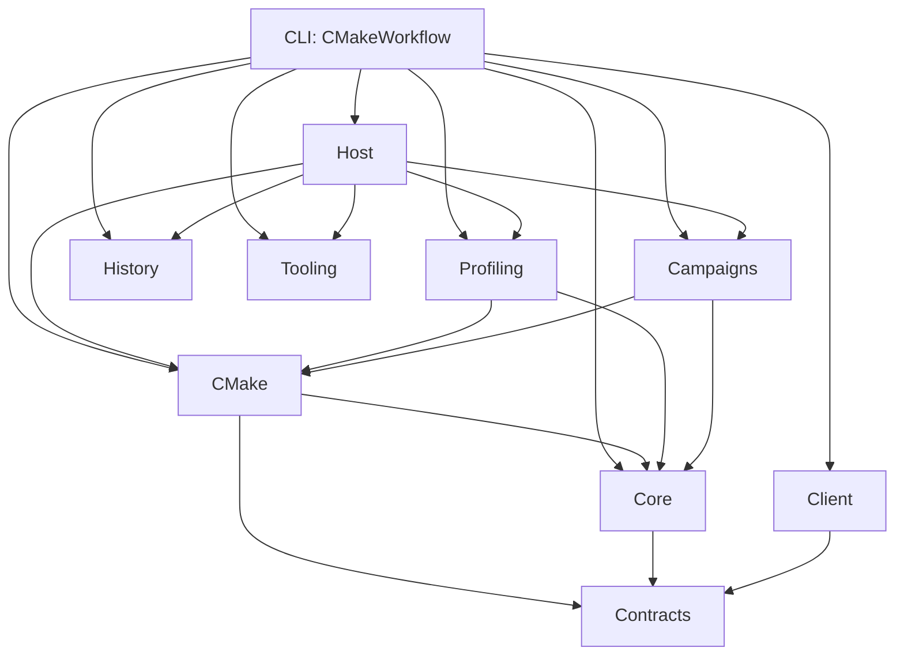
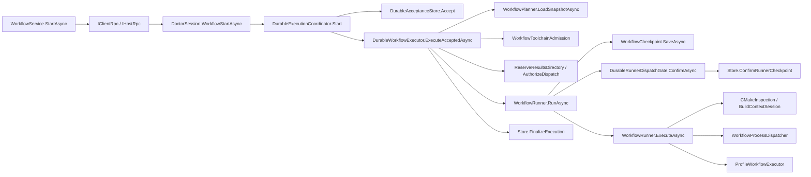
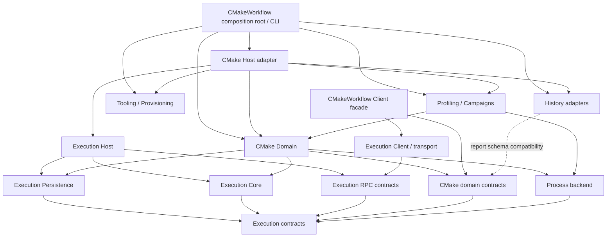

# Аудит границ Execution Engine в CMakeWorkflow

Дата: 2026-11-05. Проверенное состояние: `main`, commit `48a7e251eca9ec72ec68df34398d3257fb829b07`.

Это анализ исходников и существующих тестов, не реализация и не утверждение о прохождении CI. Во время аудита не запускались сборка, тесты, SSH, provisioning или миграции. Единственный созданный файл — этот отчёт. На начало аудита в рабочем дереве были посторонние untracked `.idea/` и `diff.txt`; они не использовались и не изменялись. Предыдущая ветка `feature/remote-host` не является текущей базой аудита.

Обозначения:

- **[Ф] Факт** — непосредственно подтверждён указанными исходниками или проверками внутри теста. Наличие теста не означает, что он был запущен или прошёл в этом аудите.
- **[В] Вывод** — архитектурная интерпретация фактов.
- **[Г] Гипотеза/предложение** — возможная будущая граница; такого API или модуля сейчас может не существовать.

Ссылки относительны этому файлу. Номера строк относятся к указанному commit. Названия проектов ниже сокращены: `CMake` означает `CMakeWorkflow.CMake`, а не внешний процесс CMake.

## 1. Главный результат

**[В] Универсальный Execution Engine можно выделить, но не механическим перемещением текущего `Core`, `WorkflowRunner` или `DurableAcceptanceStore`.** Основные engine-механизмы распределены между CMake и Host, а их входные данные, checkpoint и recovery predicates уже включают доменную семантику.

**[Ф] Текущий `Core` содержит пять исходников**: `CommandExecution`, `CommandResult`, `IWorkflowOperationExecutor`, `WorkflowOperationRequest`, `WorkflowOperationResult`. DAG, scheduler, build leases и checkpoint writer находятся в CMake. См. [Core.csproj](../CMakeWorkflow.Core/CMakeWorkflow.Core.csproj), [WorkflowRunner.RunAsync](../CMakeWorkflow.CMake/Execution/WorkflowRunner.cs#L10), [WorkflowPlanner.LoadSnapshotAsync](../CMakeWorkflow.CMake/Planning/WorkflowPlanner.cs#L24).

**[В] Практическая граница:** engine управляет графом операций, их состояниями, допуском к side effects и долговечным хранением; CMake переводит свои manifests в исполняемый граф и отвечает за допустимость/доказательства configure, build, invoke, run и ctest. Host/Client доставляют команды и владеют соединениями, но не должны самостоятельно определять, что означает корректно собранный target.

Три принципиальные оговорки:

1. **[Ф] Нет общей гарантии exactly-once для внешнего процесса.** Есть durable identity, запрет неявного повторного dispatch после authorization и карантин неопределённых результатов. Крах между side effect и записью результата оставляет неопределённость.
2. **[Ф] Есть несколько разных state machines.** Acceptance/authorization, cancellation, reconciliation/resume, node/run checkpoint и connection lifetime не сведены к одному состоянию и одному revision.
3. **[Ф] Не все существующие команды идут через durable workflow.** Локальный CLI может напрямую вызвать runner; campaign/replay RPC могут быть connection-scoped. Унификация этих путей была бы отдельным изменением семантики.

## 2. Текущий dependency graph

### 2.1. Прямые ссылки проектов

**[Ф]** Стрелка `A → B` означает прямой `ProjectReference` из A в B. Транзитивные зависимости и вызовы здесь не изображены.



Источники: [CLI](../CMakeWorkflow.csproj), [CMake](../CMakeWorkflow.CMake/CMakeWorkflow.CMake.csproj), [Host](../CMakeWorkflow.Host/CMakeWorkflow.Host.csproj), [Client](../CMakeWorkflow.Client/CMakeWorkflow.Client.csproj), [Profiling](../CMakeWorkflow.Profiling/CMakeWorkflow.Profiling.csproj), [Campaigns](../CMakeWorkflow.Campaigns/CMakeWorkflow.Campaigns.csproj).

Дополнительные факты:

- `Contracts`, `History`, `Tooling` не имеют `ProjectReference`. Это **не** доказывает их семантическую независимость от CMake.
- Client не ссылается на Host или CMake. Совместимость обеспечивается отдельными клиентскими DTO и wire-именами, а не общей сборкой RPC-моделей.
- Host и Client используют StreamJsonRpc и генерируемые shape/JSON-контракты. Client также зависит от SSH.NET.
- Host использует `Microsoft.Data.Sqlite` в своём store, но соответствующие package references находятся в [History.csproj](../CMakeWorkflow.History/CMakeWorkflow.History.csproj): `Microsoft.Data.Sqlite.Core` и SQLitePCLRaw. Это транзитивная сборочная связность, которую простой перенос store нарушит.
- `Host.Tests → Host, Client`; `Contracts.Tests → Contracts`; `tests/CMakeWorkflow.IntegrationTests.csproj` не имеет project references и проверяет внешний CLI-процесс. Выделенного `Core.Tests` в дереве нет.
- `using CMakeWorkflow.Profiling` сам по себе не означает project reference на Profiling: часть типов с этим namespace находится в Contracts. Источник assembly устанавливается по `.csproj`, а не по `using`.

### 2.2. Граф вызовов durable-запуска

**[Ф]** Это направление вызовов, не схема compile-time зависимостей:



Источники: [WorkflowService](../CMakeWorkflow.Client/Workflows/WorkflowService.cs), [ApplicationSession](../CMakeWorkflow.Host/Sessions/ApplicationSession.cs#L26), [Coordinator](../CMakeWorkflow.Host/Workflows/DurableExecutionCoordinator.cs#L18), [Executor](../CMakeWorkflow.Host/Workflows/DurableWorkflowExecutor.cs#L55).

Отдельный локальный путь: [Program](../Program.cs) → [WorkflowCommand.ExecuteAsync](../CMakeWorkflow.CMake/WorkflowCommand.cs#L10) → Planner → Runner. В нём нет обязательного Host acceptance store и dispatch gate. Сохраняется runner checkpoint, но не появляется Host operation identity автоматически.

### 2.3. Зависимости runtime-состояния

| Состояние/ресурс | Кто владеет | Кто потребляет | Существенная граница |
|---|---|---|---|
| Workspace, `.cmakeworkflow/operations.sqlite`, workspace ID | `DurableAcceptanceStore`, на стороне Host | Coordinator, Executor, operation lookup/recovery/artifacts | Identity scoped к store/workspace, не к SSH-соединению и не ко всему кластеру |
| Immutable manifest bytes + исходный base directory | Store | `LoadSnapshotAsync`, Executor | Снимок manifest не является снимком исходников, build tree или environment |
| Active tasks и cancellation sources | Один `DurableExecutionCoordinator` на persistent Host либо private stdio Host | Start/Cancel/Resume, shutdown/drain | In-memory регистрация не заменяет SQLite и межпроцессные leases |
| Operation execution lease | `DurableWorkflowExecutor` | Start/resume/reconciliation exclusion | `.cmakeworkflow/execution-locks/{operationId}.lock` |
| Results reservation | SQLite store | Executor, finalization | Сохраняется после crash/failure; не равна открытому file lock |
| `.workflow-run.lock`, `run.json` | Runner; при CLI reconciliation — reconcile command | Recovery, Host binding, report/artifacts | Один writer checkpoint; lease удерживается до выхода runner |
| Canonical build trees и session observations | `BuildTreeOwnership` + `BuildContextSession`, runner | CMake dispatch/recovery | Отдельная межпроцессная защита и CMake-specific admission |
| `active`, `remaining`, slots `jobs`, named resources | Локальные переменные `WorkflowRunner.RunAsync` | Scheduler | Scope — один run, не все операции Host |
| `events.jsonl` и sequence | `WorkflowEventJournal` | `OperationEventReplay`, SDK | Best-effort feed после checkpoint; не authoritative recovery log |
| RPC session gate + workspace + disconnect token | `DoctorSession` | Read RPC, tooling, campaigns | Не тот же lifetime, что durable workflow |
| SSH exec channel / local SSH process | `IRemoteSshConnection`, Client | JSON-RPC, diagnostics, dispose | Persistent disconnect и ephemeral disconnect имеют разные последствия |

## 3. Фактические подсистемы и их контракты

В таблице **P** — публичный CLR API; **I** — internal/private реализация; **W** — wire/on-disk контракт. Публичность здесь описывает текущий код, а не рекомендацию сделать тип частью engine SDK.

| Подсистема | Ответственность и контракты | Зависимости типов/вызовов; потребители | CMake-связывание и доказательство |
|---|---|---|---|
| Manifest и builders | P: `WorkflowDocument`, `WorkflowContext`, `WorkflowNode`, builders; W: schemaVersion 1/2 | Planner и рецепты читают/создают document; Client использует recipe/toolchain DTO из Contracts | `BuildDirectory`, configure preset, provenancePolicy, generator; node `from` требует build. [Context](../CMakeWorkflow.Contracts/Workflows/WorkflowContext.cs), [Node](../CMakeWorkflow.Contracts/Workflows/WorkflowNode.cs), [WorkflowBuilder](../CMakeWorkflow.Contracts/Builders/WorkflowBuilder.cs) |
| Нынешний Core | P: `CommandExecution.RunAsync/Sha256Async`, `CommandResult`, `IWorkflowOperationExecutor.ExecuteAsync/Supports` | Process API; `WorkflowOperationRequest` зависит от `WorkflowProfilerRequirement` в Contracts. Используется Profiling/Campaigns, extension вызывается runner | Не содержит scheduler. Request уже включает `RequiredProfiler`, `CpuSet`, affinity launcher, output directory. [Request](../CMakeWorkflow.Core/WorkflowOperationRequest.cs), [CommandExecution](../CMakeWorkflow.Core/CommandExecution.cs) |
| Planning | P: `WorkflowPlanner.LoadAsync/LoadSnapshotAsync`; I: `Ancestors`, `ValidateNode`; P: `WorkflowPlan/PlannedNode` | JSON → full-graph validation → topological order → selection closure → filesystem/CMake observations → diagnostics; потребители CLI и Executor | `PlannedNode` обязательно содержит `CMakeTargetRef`, Requested/Observed contexts. Это не нейтральный DAG IR. [Planner](../CMakeWorkflow.CMake/Planning/WorkflowPlanner.cs#L24), [PlannedNode](../CMakeWorkflow.CMake/Planning/PlannedNode.cs) |
| Scheduling | P: `WorkflowRunner.RunAsync`; I: `Conflicts`, `ExecuteAsync`, `SaveAsync` | Зависимости узлов, slots, resource/exclusive conflicts, report writer, events, backend tasks | Conflicts сравнивает physical `Target.BuildDirectory`; runner создаёт per-tree sessions и держит leases. [Runner](../CMakeWorkflow.CMake/Execution/WorkflowRunner.cs#L166), [Conflicts](../CMakeWorkflow.CMake/Execution/WorkflowRunner.cs#L360) |
| Execution admission | I: `WorkflowExecutionAdmission.Require/ValidCpuSet`; P: `WorkflowToolchainAdmission.ResolveAsync/ValidateBuildTree/RequireSameIdentity`; preflight checks в CLI/Executor | CPU affinity проверяется на Linux по `/proc/self/status` и taskset; toolchain provider materializes identities до dispatch | Toolchain admission читает `CMakeCache.txt`, сверяет compiler/generator/Ninja, запрещает неподтверждённый preset override. [Affinity](../CMakeWorkflow.CMake/Execution/WorkflowExecutionAdmission.cs), [Toolchain admission](../CMakeWorkflow.CMake/Toolchains/WorkflowToolchainAdmission.cs) |
| CMake execution semantics | I: `WorkflowRunner.ExecuteAsync/ConfigureAsync`; P: `CMakeInspection`, `CMakeBuildCommand`, `ICMakeBuildContext` | Reinspect → validate session → configure/build/invoke/run/profile/ctest → post-validation → evidence; вызывается scheduler | CMake-owned target graph не превращается в граф compiler actions. Run проверяет exact target/configuration, generation и executable hash. [ExecuteAsync](../CMakeWorkflow.CMake/Execution/WorkflowRunner.cs#L373), [ConfigureAsync](../CMakeWorkflow.CMake/Execution/WorkflowRunner.cs#L651), [Inspection](../CMakeWorkflow.CMake/Build/CMakeInspection.cs) |
| Build lifecycle и ownership | P: `BuildTreeOwnership.AcquireAsync/RejectController/PropagateTo/CanonicalPath`; P: `BuildContextSession.Observe/Validate/Configured` | Filesystem locks, canonical paths, static owned set, inherited env. Используются DAG, target/sequence commands, process dispatcher и recovery | Modes observe/adopt/managed, strict/allowUnverified, configure barriers. CanonicalPath делегирует helper из `TwoTargetWorkflow`. [Ownership](../CMakeWorkflow.CMake/Build/BuildTreeOwnership.cs), [Session](../CMakeWorkflow.CMake/Build/BuildContextSession.cs) |
| Local process mechanisms | P: `WorkflowProcessDispatcher.RunAsync`, `ProcessRunner.RunAsync`, Core `CommandExecution.RunAsync`; I: `WindowsProcessJob` | Разные stdout modes, result types, timeout/cleanup; dispatcher используется runner и ordered-command adapter | Dispatcher принимает CMake `NodeResult` и вызывает `BuildTreeOwnership.PropagateTo`. Другие runners не эквивалентны по cleanup. [Dispatcher](../CMakeWorkflow.CMake/Execution/WorkflowProcessDispatcher.cs), [ProcessRunner](../CMakeWorkflow.CMake/Execution/ProcessRunner.cs), [Windows job](../CMakeWorkflow.CMake/Execution/WindowsProcessJob.cs) |
| Profiling backend | P: `ProfileWorkflowExecutor : IWorkflowOperationExecutor`, `IProfilerBackend`, `IProfileProcess` | Perf/ETW/Instruments, `ProfileSession` и отдельные capture/result artifacts; runner вызывает extension лишь для `profile` | До вызова extension runner требует CMake build verification и artifact. Executor конкретно создаётся Host/CLI. [Profile executor](../CMakeWorkflow.Profiling/Workflows/ProfileWorkflowExecutor.cs), [ProfileProcess](../CMakeWorkflow.Profiling/Capture/ProfileProcess.cs) |
| Ordered research commands | P: `WorkflowCommandDispatcher.RunAsync`; I: PersistAsync; W: `commands.json`, stdout/stderr hashes | Caller задаёт порядок, adapter пишет intent до процесса; используется historical capture | Не второй DAG scheduler и не Host durable operation. Принадлежит CMake assembly из-за process/checkpoint зависимостей. [Command dispatcher](../CMakeWorkflow.CMake/Execution/WorkflowCommandDispatcher.cs), [Historical capture](../CMakeWorkflow.Profiling/Historical/DagFlowHistoricalCapture.cs#L90) |
| Runner persistence | I: `WorkflowCheckpoint.SaveAsync/WriteDurableBytesAsync`; P: `WorkflowReport`, `NodeResult`; W: `run.json` | Atomic replacement, disk flush, directory sync; потребители Runner, CLI reconcile, ordered commands; Host десериализует report | Report содержит CMake observations, build verification, session states, configure и toolchain evidence. [Checkpoint](../CMakeWorkflow.CMake/Recovery/WorkflowCheckpoint.cs), [NodeResult](../CMakeWorkflow.CMake/Reporting/NodeResult.cs), [Report](../CMakeWorkflow.CMake/Reporting/WorkflowReport.cs) |
| Journal/replay | I: `WorkflowEventJournal.Publish/Emit`; P: `OperationEventReplay.ReadJournalAsync`; W: `WorkflowEvent`, JSONL, sequence cursor | Scheduler публикует после Save; Host читает файл по bound run directory; SDK poll/watch | Artifact projection знает executable, DagFlow outputs и profile manifests. [Journal](../CMakeWorkflow.CMake/Recovery/WorkflowEventJournal.cs), [Replay](../CMakeWorkflow.Host/Workflows/OperationEventReplay.cs) |
| Durable acceptance | P: `DurableAcceptanceStore.Accept/AuthorizeDispatch/ReserveResultsDirectory/ConfirmRunnerCheckpoint/FinalizeExecution`; W: SQLite schema | SHA-256 snapshot, request digest, transactions; читают Coordinator, Executor, operation/recovery/results APIs | Digest содержит `workflow/start:v1`, manifest path/hash, jobs, results; store сам читает CMake `WorkflowReport`, использует Planner comparer и WorkspaceReadPaths. [Store](../CMakeWorkflow.Host/Workflows/DurableAcceptanceStore.cs#L177) |
| Host execution ownership | P: `DurableExecutionCoordinator.Start/Cancel/Resume/DrainAsync`, `DurableWorkflowExecutor.ExecuteAcceptedAsync/ExecuteResumedAsync`, gate `ConfirmAsync` | Host lifetime token; active registry; operation lease; SQLite; планирование; Runner. Потребители sessions/servers | Executor hardcodes Planner, ProfileWorkflowExecutor, WindowsWorkflowToolchainProvider; resume запускается с `jobs=1`. [Coordinator](../CMakeWorkflow.Host/Workflows/DurableExecutionCoordinator.cs), [Executor](../CMakeWorkflow.Host/Workflows/DurableWorkflowExecutor.cs), [Gate](../CMakeWorkflow.Host/Workflows/DurableRunnerDispatchGate.cs) |
| Recovery/reconciliation | P: Store `InspectRecovery/Reconcile/AdmitResume/ClaimResumeAttempt`; P: CLI `WorkflowReconcileCommand.ExecuteAsync`; W: DB decisions и embedded report audit | Operation lease/quiescence/CAS на Host; run lease/checkpoint hash на CLI; runner проверяет saved graph и evidence | CLI восстанавливает CMake session/build verification; Host decision сам checkpoint узла не исправляет. [Store recovery](../CMakeWorkflow.Host/Workflows/DurableAcceptanceStore.cs#L265), [CLI reconciliation](../CMakeWorkflow.CMake/WorkflowReconcileCommand.cs) |
| Host API/session | P/W: partial `IHostRpc`; P: partial `DoctorSession`; I: `ApplicationCallAsync`, `WorkspaceReadPaths` | Session immutable workspace, single gate, disconnect-bound reads/tooling/campaigns; durable start отдельно обращается к shared coordinator | Один RPC surface включает generic-looking operations вместе с CMake targets, profiling, recipes, history, tooling и DagFlow. [Protocol](../CMakeWorkflow.Host/Protocol/ApplicationProtocol.cs), [Session](../CMakeWorkflow.Host/Sessions/DoctorSession.cs), [ApplicationSession](../CMakeWorkflow.Host/Sessions/ApplicationSession.cs), [Paths](../CMakeWorkflow.Host/Sessions/WorkspaceReadPaths.cs) |
| Transport и activation | P: HostServer/LocalTransport/HostConnection, Client Connect/Launch; I: StdioHostServer, IRemoteSshConnection и реализации | Named pipes/UDS, framing, streams, SSH processes/channels; клиент владеет соединением. Servers создают session/coordinator | Bytes transport почти нейтрален, но server composition создаёт ToolingService/FixCoordinator, handshake содержит ToolCatalog. Команды executable: `host bridge` и `host serve --stdio`. [HostServer](../CMakeWorkflow.Host/Transport/HostServer.cs), [StdioHostServer](../CMakeWorkflow.Host/Transport/StdioHostServer.cs), [SSH.NET](../CMakeWorkflow.Client/Transport/SshNetConnection.cs) |
| SDK и protocol serialization | P: `CMakeWorkflowClient`, Workflow/Operation services; I: `IClientRpc`, `ClientJson`; W: RPC method names/DTO fields | Отдельные Host/Client DTO, generated metadata; связь с Host через wire. Client connection-bound handles, явный reconnect/find | Client Contracts dependency содержит CMake recipes/toolchain selection. `PlanAsync` возвращает JsonElement, не engine plan. [Client](../CMakeWorkflow.Client/CMakeWorkflowClient.cs), [IClientRpc](../CMakeWorkflow.Client/Protocol/IClientRpc.cs), [WorkflowOperation](../CMakeWorkflow.Client/Workflows/WorkflowOperation.cs) |
| Results/artifacts | I: `OperationArtifactReader/File`, `OperationArtifactDownloader`; P/W: artifact contracts, report snapshot | Finalization-bound report hash, opaque artifact IDs, chunked transfer, descriptor-relative no-follow reads, local download checkpoint | Catalog строится из CMake NodeResult/report. Generic transfer можно отделить от domain-specific catalog. [Reader](../CMakeWorkflow.Host/Workflows/OperationArtifactReader.cs), [Secure file](../CMakeWorkflow.Host/Workflows/OperationArtifactFile.cs), [Downloader](../CMakeWorkflow.Client/Workflows/OperationArtifactDownloader.cs) |
| History | P: `HistoryStore.Import/Runs/...`; I: `HistoryReports.Parse`; W: history DB и JSON report shapes | Читает `run.json`, profiling/campaign reports через JsonDocument; используется CLI/Host/history tooling | Compile-time независим, runtime-связь с полями report, artifacts, metrics, build environments. Это аналитический импорт, не recovery store. [HistoryReports](../CMakeWorkflow.History/Storage/HistoryReports.cs#L79), [HistoryStore](../CMakeWorkflow.History/Storage/HistoryStore.cs#L143) |
| Provisioning/tooling/campaigns | P: Tooling services, `FixCoordinator`, `SshNetHostProvisioner`, CampaignService; domain RPC | Discovery, approved install/environment, fix leases, host publish transfer, research campaigns. Не общий scheduler | Provider зависит от CMake binding; SshNetHostProvisioner ожидает executable `CMakeWorkflow`; campaign RPC connection-scoped. [TargetCampaignSession](../CMakeWorkflow.Host/Sessions/TargetCampaignSession.cs), [Provider](../CMakeWorkflow.Host/Toolchains/WindowsWorkflowToolchainProvider.cs), [Provisioner](../CMakeWorkflow.Client/Provisioning/SshNetHostProvisioner.cs) |

### 3.1. Что означают названия, а чего они не гарантируют

- **[Ф] `IWorkflowOperationExecutor` не является общим backend для любого node.** `ValidateNode` допускает закрытый список kinds; Runner вызывает extension только в ветке `profile`. `Supports(kind)` не делает систему plugin-driven.
- **[Ф] `WorkflowExecutionAdmission` не управляет Host-wide capacity.** Это проверка CPU affinity. `jobs`, `exclusive` и string resources проверяются отдельно внутри Runner.
- **[Ф] `OperationSnapshot.State` не является полным состоянием recovery.** Lookup берёт terminal state, cancellation overlay либо acceptance state; decision берётся отдельным `InspectRecovery`.
- **[Ф] `RecoverySnapshot.Revision` не является cancellation revision.** `InspectRecovery` выбирает revision reconciliation/resume; `RequestCancellation` читает `operation_cancellations.revision`. При переносе нельзя заменить их единым CAS-счётчиком без изменения протокола.
- **[Ф] `WaitForCompletionAsync` останавливается только на succeeded/failed/canceled.** Он не делает reconciliation и не интерпретирует outcome_unknown как terminal outcome: [WorkflowOperation](../CMakeWorkflow.Client/Workflows/WorkflowOperation.cs).
- **[Ф] Комментарии частично устарели.** `DurableWorkflowExecutor` и `DurableRunnerDispatchGate` ещё описывают future/opt-in bridge, но `DoctorSession.WorkflowStartAsync → Coordinator.Start → ExecuteAcceptedAsync` уже работает как публичный RPC path. Выводы выше опираются на вызовы, не на эти комментарии.

## 4. Порядок durable-записей и границы гарантий

### 4.1. Новый Host workflow

**[Ф] Наблюдаемая последовательность** из [Store](../CMakeWorkflow.Host/Workflows/DurableAcceptanceStore.cs), [Executor](../CMakeWorkflow.Host/Workflows/DurableWorkflowExecutor.cs#L55) и [Runner](../CMakeWorkflow.CMake/Execution/WorkflowRunner.cs#L210):

1. Session проверяет initialized workspace и пути; Coordinator вызывает `Accept`.
2. `Accept` в транзакции сравнивает request digest. Для нового ID читает manifest, проверяет ожидаемый SHA-256, сохраняет snapshot + operation ID + base directory + `accepted_not_dispatched`, затем commit.
3. Coordinator регистрирует Host-owned task. Его lifetime не привязан к cancellation token start RPC. Ответ о принятии и фоновые стадии могут пересекаться во времени.
4. Executor получает operation lease, повторно проверяет accepted inputs, загружает snapshot, выполняет planning/preflight/toolchain checks. Acceptance ещё не означает, что план выполним.
5. Store делает durable reservation results directory, затем `AuthorizeDispatch`. Authorization сохраняется даже если процесс не был запущен.
6. Runner получает `.workflow-run.lock`, создаёт report/session state. Для обычного запуска пишет начальный report, затем получает build-tree leases; resume получает ownership до проверки saved state.
7. Scheduler резервирует dispatch batch и ставит узлам `running`, но ещё не запускает workers. `SaveAsync` записывает checkpoint; лишь после успешной durable-записи публикует events.
8. `beforeExternalDispatch` вызывает gate: `ConfirmRunnerCheckpoint` проверяет report/manifest/authorization и коммитит SHA-256 checkpoint + run directory в SQLite.
9. Только затем запускаются `ExecuteAsync` и внешние процессы выбранных узлов. Runtime admission внутри `ExecuteAsync` ещё может отклонить операцию до процесса.
10. Scheduler заменяет state результата завершённого worker и снова сохраняет report. В конце пишет terminal report. После нормального возврата runner с 0/1/130 Executor вызывает `FinalizeExecution`, сверяя report status/hash, reserved/bound directory и manifest.

**[В] Это упорядоченный протокол нескольких commits, а не общая транзакция SQLite + filesystem + process.** Между его шагами есть crash windows; они закрываются консервативным отказом от replay, а не откатом внешнего эффекта.

**[Ф]** `WorkflowCheckpoint.WriteDurableBytesAsync` пишет temporary file, flush-to-disk и заменяет основной файл. Linux/macOS дополнительно синхронизируют каталоги; macOS использует F_FULLFSYNC; Windows — MoveFileEx с WRITE_THROUGH. Неудача durability не превращается в успешное подтверждение dispatch. Это реализация crash durability на поддержанных OS, не доказательство поведения любого filesystem/storage hardware.

**[Ф]** В `WorkflowRunner.SaveAsync` используется `CancellationToken.None`: уже начатый safety commit намеренно не отменяется пользовательским токеном. При извлечении нельзя автоматически протянуть request cancellation во все операции persistence.

### 4.2. Что authoritative, а что нет

| Источник | Что подтверждает | Чего не подтверждает |
|---|---|---|
| Accepted row + immutable bytes | Durable identity и принятые inputs | Runnable plan, созданный процесс, успешное выполнение |
| `dispatch_authorized` | Разрешение перехода к выполнению было зафиксировано | Что хотя бы один side effect произошёл или что ни одного не было |
| `run.json` с running node | Write-ahead admission узла | Сам факт запуска/завершения внешнего процесса |
| Terminal `run.json` + finalization row | Согласованный durable результат normal-return пути | Возможность произвольно заново запустить завершённую операцию |
| `events.jsonl` | Наблюдённый progress/audit по sequence | Полный state machine log, recovery checkpoint или exactly-once delivery |
| Cancellation receipt | Durable intent отменить | Мгновенное отсутствие всех внешних процессов |
| History DB | Импортированный аналитический view | Источник operation identity или разрешение resume |

### 4.3. Две разные reconciliation-процедуры

**[Ф] Host-level:** `Store.Reconcile` сохраняет immutable decision `needs_attention`/`outcome_unknown` и note, revision 1. Session требует `ConfirmedQuiescent`, проверяет local active registry и operation file lease. `AdmitResume` допускает revision 2 только для подходящего решения, без terminal/cancel intent. `ClaimResumeAttempt` делает одноразовый INSERT, не upsert: повтор после краха запрещён. Сам `Reconcile` не правит `run.json` и не запускает процессы.

**[Ф] Runner-level CLI:** `WorkflowReconcileCommand` требует quarantined `outcome_unknown`, expected checkpoint SHA-256, rationale и `--confirm-stopped`. Проверяет текущий manifest/graph, получает run/build leases, добавляет embedded audit и меняет node state по `retry` или `succeeded`. Для manual success заново собирает CMake evidence; не выдумывает exit code/duration. Для nodes с artifact/constraint declarations manual success отклоняется. После записи нужен явный resume.

**[В] Их нельзя объединить простой переименовкой decision/revision.** Одна процедура управляет Host admission/resume authority, другая — достоверностью сохранённых node outcomes. В частности, запись Host decision `needs_attention` сама по себе не делает unsafe runner checkpoint допустимым для `ClaimResumeAttempt`.

## 5. Семантические инварианты и тестовые свидетельства

Все строки ниже — **[Ф] реализация и существующие assertions**, а столбец риска — **[В]**. Состояние CI в этом аудите не проверялось.

| Гарантия и её реальный scope | Текущий владелец / реализация | Существующие тесты | Риск при переносе |
|---|---|---|---|
| Один request ID + те же inputs возвращают ту же operation identity; изменённый digest отклоняется; snapshot immutable | `DurableAcceptanceStore.Accept`, `GetSnapshot`; duplicate сравнивается до перечитывания manifest | [DurableAcceptanceTests.Run](../CMakeWorkflow.Host.Tests/Durability/DurableAcceptanceTests.cs), [DurableExecutionProcessTests.RunAsync](../CMakeWorkflow.Host.Tests/Durability/DurableExecutionProcessTests.cs), [SshWorkflowTests.ExecuteAsync](../CMakeWorkflow.Host.Tests/Transport/SshWorkflowTests.cs) | Новый normalization/hash/schema либо чтение live manifest на retry разрывает idempotency |
| Сначала checkpoint и Host binding, затем внешний dispatch | Runner `SaveAsync`; `WorkflowCheckpoint`; Gate `ConfirmAsync`; Store `ConfirmRunnerCheckpoint` | [DurableAcceptanceTests](../CMakeWorkflow.Host.Tests/Durability/DurableAcceptanceTests.cs#L107), [DurableCrashTests](../CMakeWorkflow.Host.Tests/Durability/DurableCrashTests.cs#L33), [RecoveryTests](../tests/Execution/RecoveryTests.cs#L26) | Передача executor callback до commit или split state/evidence в два несвязанных файла открывает duplicate side effects |
| После authorization/crash не выполняется неявный повтор запуска | Store authorization, Executor precondition, Coordinator Start | [DurableCrashTests](../CMakeWorkflow.Host.Tests/Durability/DurableCrashTests.cs), [DurableExecutionProcessTests](../CMakeWorkflow.Host.Tests/Durability/DurableExecutionProcessTests.cs), [SshWorkflowTests.LostReplyAsync](../CMakeWorkflow.Host.Tests/Transport/SshWorkflowTests.cs) | Generic retry policy может ошибочно трактовать transport failure как rejection |
| Interrupted running/resuming checkpoint становится outcome_unknown и не replay-ится автоматически | Runner resume branch до восстановления sessions; CLI reconciliation; Store resume guards | [WorkflowTests](../tests/Execution/WorkflowTests.cs#L341), [RecoveryTests](../tests/Execution/RecoveryTests.cs), [DurableRecoveryTests](../CMakeWorkflow.Host.Tests/Durability/DurableRecoveryTests.cs), [ResumeReplayTests](../CMakeWorkflow.Host.Tests/Durability/ResumeReplayTests.cs) | Universal enum `Failed/Retryable` потеряет неизвестность результата |
| Explicit resume сохраняет succeeded prefix и не перезапускает уже выполненные узлы | Runner graph/evidence checks; `ClaimResumeAttempt`; operation lease | [DurableResumeExecutionWireTests](../CMakeWorkflow.Host.Tests/Durability/DurableResumeExecutionWireTests.cs), [ResumeReplayTests](../CMakeWorkflow.Host.Tests/Durability/ResumeReplayTests.cs) | Удаление domain evidence или повтор claim после исключения превратит resume в replay |
| Terminal result согласован с runner exit code, manifest и run ownership | `FinalizeExecution`; только normal-return 0/1/130 | [DurableExecutionProcessTests](../CMakeWorkflow.Host.Tests/Durability/DurableExecutionProcessTests.cs), [DurableCancellationWireTests](../CMakeWorkflow.Host.Tests/Durability/DurableCancellationWireTests.cs), [SshArtifactTests](../CMakeWorkflow.Host.Tests/Transport/SshArtifactTests.cs) | Finalization в catch/finally скрывает crash gap и outcome_unknown |
| Cancellation intent durable, revisioned, idempotent; cancel до authorization запрещает authorize | Store `RequestCancellation/AuthorizeDispatch`; Coordinator.Cancel вызывает execution CTS после commit | [DurableAcceptanceTests](../CMakeWorkflow.Host.Tests/Durability/DurableAcceptanceTests.cs#L170), [DurableCancellationWireTests](../CMakeWorkflow.Host.Tests/Durability/DurableCancellationWireTests.cs), [SshWorkflowTests.CancelAsync](../CMakeWorkflow.Host.Tests/Transport/SshWorkflowTests.cs) | Замена intent отменой RPC или смешение cancellation/recovery revisions |
| Node timeout отличается от user cancellation; cleanup перед возвращением result | Runner deadline/catch; WorkflowProcessDispatcher; WindowsProcessJob | [WorkflowTests timeout/process-tree](../tests/Execution/WorkflowTests.cs#L201), [LifecycleTests SIGINT](../tests/Execution/LifecycleTests.cs#L319), [DurableCancellationWireTests](../CMakeWorkflow.Host.Tests/Durability/DurableCancellationWireTests.cs) | Подмена runner на Core.CommandExecution меняет logs, tree ownership и Windows descendant semantics |
| jobs/exclusive/resources и общая physical build directory ограничивают concurrency внутри run | Runner ready/dispatch batch и `Conflicts` | [WorkflowTests scheduling](../tests/Execution/WorkflowTests.cs#L216) | Потеря implicit tree-resource или изменение drain-first порядка exclusive nodes |
| Cooperating процессы не мутируют один tree одновременно; nested same-tree execution запрещён | BuildTreeOwnership: sorted canonical locks, RejectController, propagated owned-tree env | [WorkflowTests lease/alias](../tests/Execution/WorkflowTests.cs#L247), [BoundaryTests nested execution](../tests/Execution/BoundaryTests.cs#L204) | Canonicalization, lock location, ordering или env hook изменены независимо от domain |
| Observation не выдаётся за ownership/provenance; run требует проверенный exact build artifact | BuildContextSession; CMakeInspection; Runner build/run postchecks и hash | [BoundaryTests](../tests/Execution/BoundaryTests.cs), [LifecycleTests](../tests/Execution/LifecycleTests.cs), [ArtifactTests](../tests/Execution/ArtifactTests.cs) | Plain process success ошибочно станет доказательством корректного build target |
| Persistent accepted work переживает disconnect; private stdio Host связан с channel lifetime | HostServer shared coordinator против StdioHostServer private coordinator; SDK dispose не вызывает operations/cancel | [DurableWorkflowWireTests](../CMakeWorkflow.Host.Tests/Durability/DurableWorkflowWireTests.cs), [SshWorkflowTests](../CMakeWorkflow.Host.Tests/Transport/SshWorkflowTests.cs), [SshNetContractTests](../CMakeWorkflow.Host.Tests/Transport/SshNetContractTests.cs), [SshNetLiveLifecycleTests](../CMakeWorkflow.Host.Tests/Transport/SshNetLiveLifecycleTests.cs) | Единый session token при split Host будет отменять persistent work или оставлять private work |
| Reconnect/find и event replay не redispatch-ят workflow; cursor учитывает порядок событий | OperationService, WorkflowOperation, OperationEventReplay | [ResumeReplayTests](../CMakeWorkflow.Host.Tests/Durability/ResumeReplayTests.cs), [SshWorkflowTests](../CMakeWorkflow.Host.Tests/Transport/SshWorkflowTests.cs), [SshLostReplyPeer](../CMakeWorkflow.Host.Tests/Transport/SshLostReplyPeer.cs) | Универсальный reconnect middleware может сам повторить mutation |
| Results retrieval ограничен bound run root, проверяет final report и hashes; chunks bounded | OperationArtifactReader/File; Downloader | [SshArtifactTests](../CMakeWorkflow.Host.Tests/Transport/SshArtifactTests.cs), [ArtifactPathBoundaryTests](../CMakeWorkflow.Host.Tests/Transport/ArtifactPathBoundaryTests.cs), [SshDownloadTests](../CMakeWorkflow.Host.Tests/Transport/SshDownloadTests.cs) | Generic filesystem API вместо opaque ID или lexical path check вместо handle-relative open |
| RPC и package SDK пригодны для статической metadata/AOT модели | HostJson/ClientJson/WorkflowJson, generated shapes, packaging | [Client.AotSmoke](../CMakeWorkflow.Client.AotSmoke), [ci-native-smoke.ps1](../scripts/ci-native-smoke.ps1), [CI configuration](../.github/workflows/ci.yml) | Перенос типов без обновления generated resolvers, reflection-only backend payload или неполный NuGet dependency graph |

### 5.1. Ограничения, которые нельзя выдать за гарантии engine

- **[Ф] Named resources и Exclusive не имеют Host-wide/global registry.** Две независимые операции на разных build trees могут использовать одно строковое имя ресурса. Межпроцессная защита относится к tree/run/operation leases, а не ко всем resource names.
- **[Ф] `jobs` ограничивает workflow nodes, не число compiler processes и не общий бюджет Host.** Native scheduling остаётся у CMake/Ninja; Host limit 16 относится к клиентским соединениям.
- **[Ф] Build-tree leases cooperative.** Обычный IDE/Ninja процесс не обязан соблюдать lock protocol. CMake observations и post-validation нужны даже при наличии lease.
- **[Ф] Process custody неодинакова.** WindowsProcessJob прямо документирует окно между `Process.Start` и assignment; он не создаёт процесс suspended. Core.CommandExecution и ProcessRunner не используют этот Job wrapper. Нельзя при переносе обещать единый bounded cleanup для всех executors и crash modes.
- **[Ф] `CommandExecution` буферизует stdout/stderr целиком и при cleanup использует ожидания без cancellation; WorkflowProcessDispatcher пишет streams в файлы и отдельно обрабатывает descendants.** Это разные контракты, не взаимозаменяемые реализации одного уже существующего backend interface.
- **[Ф] Durable acceptance не включает runnable-plan validation.** Planning failure в background task логируется Coordinator; нельзя автоматически переименовать accepted receipt в «job scheduled successfully».
- **[Ф] Cancellation до dispatch не обязана дать terminal report.** Store сохраняет cancel intent и запрещает authorization; pre-run путь может не создать bound run, нужный `FinalizeExecution`. API уже различает `cancel_requested` и `canceled`.
- **[Ф] Recovery имеет ограниченную модель attempt.** Resume admission revision 2 и один `operation_resume_attempts` на operation; это не произвольная retry history. Executor resume использует jobs=1.
- **[Ф] Durable snapshot фиксирует manifest, а не все inputs/environment.** Source/build identity проверяется отдельными runtime механизмами; заявлять reproducible snapshot execution на этом основании нельзя.
- **[Ф] Journal может отсутствовать или потерять хвост.** Reader игнорирует truncated final JSON line, отвергает немонотонный sequence и oversized records; это не durable message queue. Replay не даёт consumer exactly-once processing без его собственного cursor persistence.
- **[Ф] WorkspaceReadPaths и OperationArtifactFile — разные уровни защиты.** Первый canonicalizes/проверяет путь; второй использует descriptor-relative no-follow open. Нельзя распространять race-resistant artifact-read гарантию на любой существующий path check или исполнение произвольного CMake script.
- **[В] Это trusted-user execution service с filesystem boundaries, а не sandbox для недоверенного manifest.** Manifest запускает CMake/project commands под правами Host user; SSH pin/pipe permissions не ограничивают side effects этих программ до workspace.

### 5.2. Покрытие тестами: чего именно оно доказывает меньше

**[Ф]** Host `DurableCrashTests` пропускается вне Linux. CLI `RecoveryTests` требует fault-injection build (`RecoveryFaultInjection=true`); отдельная post-rename точка не используется на Windows, где replacement другой. Нельзя обозначать эти тесты как одинаково проверяющие все OS/filesystems.

**[Ф]** В текущем commit уже есть [SSH.NET real-sshd CI](../.github/workflows/sshnet-real-sshd.yml) и [изолированный SSH test harness](../tests/infrastructure/sshnet/run-tests.sh). Они покрывают real SSH и provisioning, но наличие workflow файла не подтверждает успешный CI run. F3 lifecycle test проверяет channel disposal, не произвольный network partition/sshd/kernel crash.

**[Ф]** Большая часть DAG/lifecycle assertions находится в интеграционном CLI harness. Его [Program](../tests/Program.cs) имеет отдельные selectors `--recovery` и `--remote-cli`, но не отдельный selector каждого DAG класса. У Host.Tests есть узкие SSH/artifact/contract selectors и `--durable-workflow-wire-tests`, однако не каждый durable class доступен отдельным flag.

**[В] Пробел для выделения:** нет отдельного набора neutral scheduler contract tests без CMake/filesystem observations. Поэтому первым шагом нельзя считать «перенести runner, затем посмотреть, какие тесты упадут».

## 6. Классификация: keep / move / split / redesign

Действия — **[Г]**, не указания начать изменения. `move` означает перенос без обещания сохранить assembly identity автоматически; `split` — разделить конкретные ответственности; `redesign` — сначала определить semantics/ownership и совместимость. Одному текущему типу могут соответствовать несколько будущих областей.

| Текущий компонент | Будущая категория | Решение | Что сохранять / причина |
|---|---|---|---|
| Pure topological validation, selection closure, dependency bookkeeping в Planner | Execution Core | **split → move** | Стабильный порядок и full-graph validation, включая unselected cycles; domain validation оставить снаружи |
| WorkflowDocument/Context/Node + recipes/builders | CMake Domain, частично Execution Core contracts | **keep + split** | CMake manifest v1/v2 сохранить; общие node IDs/dependencies/resources не требуют переноса всех domain fields |
| WorkflowPlan/PlannedNode | CMake Domain → neutral execution plan boundary | **split** | Удалить требование CMakeTargetRef у каждого neutral node через доменную проекцию, не потеряв associations/evidence |
| Scheduler loop WorkflowRunner | Execution Core | **split** | Сохранить один scheduler, jobs/dependency/exclusive semantics и single-writer checkpoint |
| Runner.ExecuteAsync/ConfigureAsync, CMakeInspection/File API, BuildContextSession | CMake Domain / CMake backend | **keep** | Здесь находятся доказательства допустимости и результата CMake action |
| BuildTreeOwnership | CMake Domain + малый механизм resource lease | **split позже** | Canonical tree identity и nested-build policy остаются CMake; primitive file lease можно отделить только с прежним scope |
| Resource string conflicts / Exclusive | Execution Core | **move при split scheduler** | Не превращать автоматически в global/cluster resource manager |
| WorkflowExecutionAdmission CPU set checks | Execution Backends admission | **split** | OS capability/launch constraints, не универсальная CMake или profiler policy |
| CommandExecution/CommandResult | Execution Backends / базовые утилиты | **move без унификации** | Мало type coupling, но whole-output/timeout semantics нужно сохранить; Core→Contracts dependency отдельно разобрать |
| WorkflowProcessDispatcher/WindowsProcessJob | Execution Backends | **split** | Нужен process input/output contract без NodeResult и отдельная CMake ownership propagation |
| ProcessRunner | Other / локальный CLI backend | **keep сначала** | Inherited stdio отличается от captured process backend |
| IWorkflowOperationExecutor/Request/Result | Profiling boundary, затем backend boundary | **split/redesign** | Существующая точка расширения только profile; RequiredProfiler не должен стать обязательным universal request field |
| ProfileWorkflowExecutor и backend implementations | Execution Backends + Profiling Domain | **keep + adapter** | Сохранить capture lifecycle/capabilities; не переносить perf/ETW semantics в scheduler |
| WorkflowCheckpoint byte writer | Execution Persistence | **split → move** | Atomic write primitive отделим от WorkflowReport serializer; сохранить durable ordering и fault points |
| WorkflowReport/NodeResult/WorkflowJson | Execution Persistence contracts + CMake evidence/report facade | **split/redesign** | State и domain evidence должны коммититься согласованно; serialized compatibility и hashes обязательны |
| WorkflowEventJournal и artifact projection | Execution Persistence / наблюдаемость + CMake Domain | **split** | Journal остаётся best-effort; domain artifact enumeration отдельно |
| DurableAcceptanceStore | Execution Persistence | **split/redesign** | Generic transactions/identity отдельно от чтения CMake report, digest и validators; сохранить текущую БД |
| DurableExecutionCoordinator | Execution Host/Core operation lifecycle | **split** | Host-owned tasks можно отделить от CMake execution orchestration, не меняя token ownership |
| DurableWorkflowExecutor и dispatch gate | CMake execution adapter + Execution Host/Persistence | **split** | Gate placement и outer lease сохранить; CMake planner/toolchain/profile wiring вынести в composition |
| WorkflowReconcileCommand, runner recovery predicates | CMake Domain + Persistence lifecycle | **keep доменные predicates / redesign boundary** | Manual success CMake-specific; произвольный backend не умеет подтвердить его по статусу процесса |
| LocalTransport/StdioBridge/SSH byte transport | Execution Host / Client transport | **move с compatibility facade** | Механизм почти нейтрален; names/endpoint conventions/remote command surface сохранить |
| HostServer/StdioHostServer/DoctorSession | Execution Host + CMake Host composition | **split** | Разделить lifetimes и domain service factory, не объединять persistent и private ownership |
| IHostRpc/IClientRpc, HostJson/ClientJson | Execution Host / Client + CMake RPC facade | **split постепенно** | Существующие wire methods/DTO shapes и source-generation roots остаются совместимыми |
| Artifact file/chunk/download mechanics | Execution Host / Client / Persistence | **split → move** | Generic безопасный transfer отдельно от CMake report catalog; не терять descriptor authority |
| WorkflowCommandDispatcher | Other / Execution Persistence + backend | **keep сначала, split mechanics** | Caller-owned ordered commands не становятся вторым DAG scheduler и не приобретают Host acceptance задним числом |
| History | Other / аналитический consumer | **keep** | Совместимость report imports; не переносить history database в execution authority |
| Tooling, FixCoordinator, SSH provisioning | Other / deployment & environment | **keep** | Не часть neutral engine scheduler; сохранить явные approval/identity boundaries |
| Campaigns, DagFlowHarnessSnapshot, recipe families | Domain/Other | **keep** | Они потребители engine primitives, но имеют независимые правила output/campaign lifecycle |

## 7. Скрытые связности и блокеры выделения

Ниже перечислены выявленные в проверенных путях существенные compile-time, call-level и runtime препятствия. **[В] Это блокеры механического переноса, не список подтверждённых production bugs.**

1. **[Ф] Contracts уже CMake-specific.** Core ссылается на Contracts через profiler requirements; neutral plan не получится простым rename проекта.
2. **[Ф] Plan, result и checkpoint связаны одними domain types.** `PlannedNode.Target`, `NodeResult.BuildVerification/Artifact/Session*`, `WorkflowReport.BuildEnvironments/Toolchains`. Удаление полей меняет не только API, но recovery predicates.
3. **[Ф] Scheduler одновременно выполняет domain work.** `ExecuteAsync`, ConfigureAsync и resume validation в одном Runner с scheduling loop. Одного нового backend interface без отделения report/state недостаточно.
4. **[Ф] Неявный resource key — canonical build directory.** String resources не заменяют его и не имеют такого же межпроцессного scope. Все tree aliases должны продолжать сходиться к одной identity.
5. **[Ф] Canonicalization размещена в domain recipe helper.** `BuildTreeOwnership.CanonicalPath → TwoTargetWorkflow.CanonicalExistingDirectory`; Host paths и store зависят от этой цепочки и Planner.PathComparer.
6. **[Ф] Process environment несёт ownership.** `CMAKE_WORKFLOW_OWNED_TREES`, `CMAKE_WORKFLOW_CONTROLLER_BUILD_DIR`, static process-wide owned set и PropagateTo связывают direct child launch с nested-build safety. Нельзя удалить hook при переносе ProcessStartInfo в общий backend.
7. **[Ф] Store не просто key/value persistence.** `ConfirmRunnerCheckpoint`, `ClaimResumeAttempt`, `FinalizeExecution` сами десериализуют WorkflowReport и проверяют его lifecycle; store зависит от CMake.Serialization и Host.WorkspaceReadPaths.
8. **[Ф] Digest/identity включают path semantics.** Original manifest path/base, canonical result path, Windows case normalization reservation, string discriminator `workflow/start:v1`, jobs. Изменение canonicalization или введение backend ID влияет на existing request equivalence.
9. **[Ф] Модель авторитета распределена.** Active registry, operation lease, run lease, build-tree lease и persistent results reservation не взаимозаменяемы. Scope и lifetime нельзя объединить в один `Lock` без redesign.
10. **[Ф] Run lease и build ownership имеют разные интервалы.** `.workflow-run.lock` живёт до выхода RunAsync. Для обычного run build ownership освобождается после drain active workers, перед финальным SaveAsync; для resume отдельный `resumedOwnership` живёт до выхода метода. Не следует переносить комментарий «lease spans execution» как точное описание всех locks.
11. **[Ф] Recovery revisions разделены.** Cancellation row 0/1, reconciliation 0/1, resume admission 2, run checkpoint SHA-256 и audit history — разные concurrency tokens. Поле с названием Revision не общий ETag состояния.
12. **[Ф] Два replay-resistant протокола.** Host operation resume и ordered-command `commands.json` имеют разные identities/checkpoints. Campaign/replay RPC вообще connection-scoped; generic engine не должен незаметно дать им durable semantics.
13. **[Ф] Persistence format — совместимость между assemblies и инструментами.** Host, Client report view, History JsonDocument parser, CLI reconcile, tests и source-generated serializers читают одни и те же формы. JSON schema changes могут не проявиться как compile error.
14. **[Ф] Есть несколько process execution механизмов.** Core.CommandExecution, CMake.ProcessRunner, WorkflowProcessDispatcher, Profiling.ProfileProcess и Tooling runtime. Замена их одним executor меняет process ownership, buffering и timeout behavior.
15. **[Ф] Host — composition root доменных сервисов.** Servers создают ToolingService/installer/FixCoordinator; Executor создаёт профильный backend и Windows toolchain provider. Новый universal Host должен получать готовую domain composition, а не ссылаться обратно на CMake.
16. **[Ф] Client compile-time separation скрывает wire coupling.** Дублируемые DTO должны оставаться согласованными с Host. Нельзя считать перенос CLR-типа достаточным изменением RPC контракта.
17. **[Ф] AOT registration закрыта.** WorkflowJson disallows unmapped members; Host/Client Json contexts и PolyType shapes перечислены явно. Runtime scanning или `object`-payload без metadata не является совместимым shortcut.
18. **[Ф] Results authorization привязана к CMake report shape.** Generic chunk transfer не должен сам принимать произвольный путь: сначала операция → verified terminal report → catalog candidate → anchored open.
19. **[Ф] Package/runtime coupling не равен project graph.** SQLite packages приходят Host через History; SDK package-only AOT smoke проверяет отсутствие project-reference обхода. Новые assemblies потребуют явного packaging анализа.
20. **[В] Execution Engine пока не имеет независимого доказанного non-CMake DAG consumer.** Historical ordered commands — свидетельство повторного использования process/persistence mechanics, но не доказательство универсальности scheduler или resume модели.

## 8. Минимальная целевая граница

### 8.1. Целевой dependency graph

**[Г]** Это логические модули, не предложение немедленно создать столько `.csproj`. Стрелки обозначают зависимости; существующие публичные CLI/SDK остаются compatibility facades. Две формы «Contracts» ниже специально различаются: neutral execution contracts и прежние CMake domain contracts.



**[Г] Основное правило:** `Execution Core`, `Execution Persistence` и базовый `Execution Host/Client` не должны зависеть от CMake domain assemblies. CMake adapter знает engine и подаёт ему подготовленные функции/данные; composition root знает обе стороны. Domain persistence adapter может пользоваться neutral durable writer, а neutral persistence не десериализует CMake report самостоятельно.

Зависимость `Profiling/Campaigns → CMake Domain` пока допустима: существующие CMake workflows и research preparations не требуется универсализировать ради выделения scheduler. History dotted edge — зависимость формата, не обязательный новый ProjectReference.

### 8.2. Нужные точки разреза, подтверждённые кодом

| Необходимая граница [Г] | Какая текущая связь вынуждает её ввести [Ф] | Минимальная форма и ограничения |
|---|---|---|
| Domain plan → neutral scheduling inputs | PlannedNode всегда требует Target/Requested/Observed | Node identity, dependencies, conflict keys, exclusivity и execution binding. CMake сам вычисляет physical-tree key и не отдаёт engine CMake File API parser |
| Scheduler → выполнение одного node | Runner.ExecuteAsync содержит domain switch и принимает BuildContextSession | Узкий явно переданный executor/callback, сохраняющий отдельный worker result и scheduler-owned state. Не registry, scanning или универсальная plugin factory |
| Engine checkpoint → domain evidence encoding/validation | Store и Runner знают WorkflowReport/NodeResult | Adapter сериализует единый согласованный checkpoint с execution state и domain evidence; typed/generated metadata. Не два независимо коммитящихся файла и не непроверяемый opaque blob |
| Host coordinator → execution strategy | Coordinator напрямую вызывает DurableWorkflowExecutor | Переданная CMake orchestration вместо создания типов внутри neutral Host. Сохранить gate, one-shot claim, операции leases и Host lifetime |
| Process backend → domain environment ownership | WorkflowProcessDispatcher читает NodeResult и PropagateTo | Process spec/result без CMake types; CMake adapter сохраняет env propagation и log identity до запуска. OS-specific supervision остаётся backend concern |
| Neutral lifecycle validation → domain recovery validation | Resume восстанавливает BuildContextSession и сверяет generation/artifact/toolchain | CMake validator остаётся обязательным и вызывается под прежними leases до claim/dispatch в правильной фазе. Generic «resume all failed» не вводится |

Не требуется новая абстракция для всего подряд. Уже существуют Stream-пара transport, `beforeExternalDispatch`, `IWorkflowToolchainProvider`, profile executor seam. Сначала нужно ограничить их фактические обязанности, а не добавить общий service locator, second scheduler или универсальный storage provider.

### 8.3. По степени изменения семантики

**Можно извлечь почти механически, после characterization tests:**

- **[Г]** Pure graph ordering/cycle detection/selection closure после выделения из `LoadSnapshotAsync`; вход — IDs/edges, без filesystem reads.
- **[Г]** SHA-256 helper и CommandResult, byte-stream bridge/copy, bounded diagnostics — при сохранении API facade и names. Это подготовительные utilities, не готовый Engine.
- **[Г]** Durable byte writer из WorkflowCheckpoint отдельно от WorkflowReport serializer; OS-specific ordering и fault injection hooks сохраняются буквально.
- **[Г]** Journal framing/cursor validation отдельно от domain event/artifact projection; transport-neutral contract types — только после проверки фактических fields.

**Требует изменения интерфейсов:**

- **[Г]** PlannedNode/WorkflowPlan, worker request/result, ProcessDispatcher input, Host execution binding, Client/Host protocol partition и generated metadata.
- **[Г]** Разделение profiling constraints от generic node execution contract; `IWorkflowOperationExecutor` в текущем виде недостаточен.
- **[Г]** Удаление CMake report десериализации из neutral store через domain validation boundary, с сохранением existing on-disk representation.

**Требует переработки состояния/ownership и поэтому отдельного design gate:**

- **[Г]** Разделение lifecycle state и CMake evidence, чтобы они по-прежнему коммитились атомарно как единый checkpoint.
- **[Г]** Перенос outer operation lease, run lease и domain build-tree leases без изменения порядка acquisition/release.
- **[Г]** Composition persistent/private Host lifetimes; разделение cancellation revisions и recovery revisions в новом API без изменения старого wire surface.
- **[Г]** Любой переход к нескольким backends в одной operation должен сохранять identity каждого backend binding и его recovery validation. Такая модель сейчас не доказана.

**Пока нельзя безопасно обобщить без новых требований/доказательств:**

- **[В]** CMake generation/provenance и manual success evidence в «generic successful process».
- **[В]** Per-run resources в distributed/global capacity scheduler; cooperative build leases в изоляцию от любых внешних writers.
- **[В]** Arbitrary backend resume/retry: one-shot SQLite claim и outcome_unknown не дают универсальной retry policy.
- **[В]** Все process runners в один backend с обещанием одинакового cleanup, особенно hard-kill/Windows pre-assignment race.
- **[В]** History, campaign journals и accepted operations в одну database/state machine.
- **[В]** Universal manifest/plugin payload или новый network protocol. В коде нет необходимости менять их одновременно с выделением engine.

## 9. Последовательность миграции — только план

Каждый этап заканчивается отдельно проверенным increment. Нельзя одновременно менять scheduler, checkpoint schema и operation identity. При неуспехе сохраняется прежний production path; новый scheduler параллельно старому не создаётся.

| Этап | Небольшое изменение [Г] | Что остаётся работоспособным | Gate и проверки |
|---|---|---|---|
| 0. Зафиксировать совместимость | Characterization fixtures manifest/plan/report/events/SQLite states; явно перечислить invariants и selectors | Все production code paths неизменны | Contracts.Tests; выделенные graph tests; cases existing store migration, duplicate/conflict IDs, cancellation/recovery revisions; fixtures сериализации до/после |
| 1. Pure DAG seam | В том же assembly отделить full-graph validation/topological ordering/selection closure от CMake observations | WorkflowPlanner.LoadSnapshotAsync остаётся публичным входом и вызывает тот же алгоритм | Cycles в unselected branch, missing dependency/selected node, stable order, from/artifact edges добавляются до neutral phase. CLI WorkflowTests; текущий harness для него не имеет отдельного selector — предусмотреть selector, не изобретать существующую команду |
| 2. Низкоуровневая persistence seam | Разделить durable byte-write и CMake report serialization, не менять run.json bytes/schema и gate order | Старые CLI resume/reconcile и Host продолжают читать прежний report | RecoveryTests с fault build; DurableAcceptanceTests checkpoint binding; failure-after-flush/replace, no-side-effects-before-confirm; OS-specific Windows/Linux checks |
| 3. Process boundary | Отделить plain process input/output от NodeResult; CMake adapter выполняет ownership/env/log projection | CMake и ordered-command adapter используют тот же underlying dispatcher | WorkflowTests timeout, LifecycleTests cancellation, DurableCancellationWireTests; Windows ETW/job cleanup; Profiling/Historical tests. Не заменять CommandExecution/ProcessRunner автоматически |
| 4. Domain executor внутри текущего Runner | Выделить ExecuteAsync/ConfigureAsync и session/recovery validators, сохранив один scheduling loop | Старые manifest, planner, report и CMake checks сохранены | Boundary/Lifecycle/Artifact/Toolchain tests; scheduler parallel/exclusive/resources; succeeded process + rejected provenance остаётся rejected node |
| 5. Neutral execution contracts/Core | Перенести уже изолированные graph/scheduler части; CMake подаёт plan/executor и conflict keys | CLI и Host используют CMake compatibility adapter, public methods не исчезают | Dependency check: neutral assembly не ссылается на CMake/Profiling; pure scheduler tests; прежние CLI workflows; compare report/manifest identity и scheduling outcomes |
| 6. Persistence/operation ownership | Разделить CMake validators и generic operation store/coordinator mechanics, сохранив БД, discriminator, paths и leases | Existing operation IDs, accepted snapshots, reserved directories и reconciliation остаются читаемыми | DurableAcceptance/ExecutionProcess/Crash/Recovery/ResumeReplay/ResumeExecution/Cancellation; same SQLite file reopening; crash boundary counts и no duplicate effects. Нельзя считать acceptance test заменой crash suite |
| 7. Host/Client split | Domain-neutral transport/session shell + CMake composition/compatibility RPC facade | Старые wire names, SDK и persistent/private lifetime semantics работают | Host contract tests, bridge, SSH lifecycle, SSH workflow lost-reply/reconnect, SSH.NET real-sshd, results/download path tests; generated serializers и package-only AOT smoke |
| 8. Проверить независимость | Малый deterministic non-CMake in-process test executor использует извлечённый Core; не production plugin system | CMake остаётся первым полноценным production consumer | Graph/state/checkpoint/cancel invariants без CMake File API/types; затем release compatibility gate существующего CLI/SDK. Новые generic backend guarantees отдельно обосновываются |

### 9.1. Как выполнять validation при будущей миграции

**[Ф] Существующие узкие точки запуска** (команды ниже в этом аудите не выполнялись):

```sh
# Сборка затронутого Host/SDK/test dependency closure, не всей CI-матрицы.
timeout 120s dotnet build CMakeWorkflow.Host.Tests/CMakeWorkflow.Host.Tests.csproj \
  -c Release --no-restore -m:1 -p:BuildInParallel=false

# Выбирать только относящийся к этапу selector, каждый запуск ограничен снаружи.
timeout --kill-after=5s 90s dotnet \
  CMakeWorkflow.Host.Tests/bin/Release/net10.0/CMakeWorkflow.Host.Tests.dll \
  --durable-workflow-wire-tests

timeout --kill-after=5s 90s dotnet \
  CMakeWorkflow.Host.Tests/bin/Release/net10.0/CMakeWorkflow.Host.Tests.dll \
  --ssh-workflow-tests lost-reply

timeout --kill-after=5s 30s dotnet \
  CMakeWorkflow.Host.Tests/bin/Release/net10.0/CMakeWorkflow.Host.Tests.dll \
  --sshnet-contract-tests
```

Для CLI crash tests нужен отдельный CLI, собранный с `RecoveryFaultInjection=true`, затем `tests/bin/Release/net10.0/CMakeWorkflow.IntegrationTests.dll <CLI> --recovery`; normal release build этих hooks не содержит. Для RPC cancellation используются существующие `RpcCancellationTesting`/NativeAOT smoke пути, см. [CI](../.github/workflows/ci.yml) и [smoke script](../scripts/ci-native-smoke.ps1).

Selectors вроде `--artifact-path-tests`, `--ssh-artifact-tests`, `--ssh-download-tests` уже есть в [Host.Tests Program](../CMakeWorkflow.Host.Tests/Program.cs). Для durable classes без selector потребуется маленькая test-only точка входа; полный suite не следует повторять после каждого локального изменения.

NativeAOT/package checks нужны при смене assemblies/serialization/contracts, не после каждого перемещения private helper. Реальный SSH harness запускается отдельно в подходящем окружении; его наличие не заменяет deterministic in-process/crash tests. Windows-проверка обязана включать named pipes и descendant cleanup, Linux — реальные lease/crash boundaries. Результаты CI и доступность IPC нужно фиксировать отдельно от «тест присутствует».

## 10. Risk matrix

Оценки **[В]** качественные: вероятность регрессии при предложенном изменении границы без специальных mitigations, а не измеренная частота сбоев текущего продукта.

| Изменение / риск | Вероятность | Ущерб | Почему | Минимальный mitigation / gate |
|---|---|---|---|---|
| Worker получает управление до durable gate | Высокая | Критический: повтор side effects после crash | Gate сейчас расположен между конкретными await в Runner | Crash injection на каждом переходе, count реальных effects |
| Разделённые commits state и domain evidence | Высокая | Критический: unsafe resume или ложный success | NodeResult одновременно lifecycle и provenance record | Один checkpoint commit; stale/torn/tampered evidence tests |
| Смешение RPC cancellation и operation lifetime | Высокая | Высокий: persistent work исчезает при disconnect | Различные CTS и серверная composition | Disconnect initiating/cancelling clients; persistent/private comparative tests |
| Generic автоматический retry после ambiguous response | Средняя | Критический: дублированное действие | Transport outcome не равен admission outcome | Lost-reply fault + find по saved request ID, отсутствие второго start |
| Потеря build identity/provenance checks | Высокая | Критический: исполнение чужого/устаревшего artifact | Generation/target/hash/session проверки распределены | Boundary/Lifecycle/Artifact tests; post-build mutation cases |
| Изменение lock keys/scope/lifetime | Высокая | Высокий: concurrency corruption или deadlock | Canonical paths, sorted acquisition, nested env | Alias/cross-process/nested-build tests; тот же order acquisition |
| Generic revision/terminal-state simplification | Высокая | Высокий: ложная отмена/resume authority | Несколько DB tables и разные CAS domains | Separate cancellation/reconcile/resume tests и fixtures всех состояний |
| Унификация process launch helpers | Средняя–высокая | Высокий: orphan descendants/pipe hang | Разные job/stdio/timeout contracts | Windows process-tree tests; Linux cancel/drain; preserve runner variants |
| Изменение accepted digest/workspace/path identity | Средняя | Высокий: конфликт старых IDs или duplicate acceptance | Path/hash inputs входят в persisted request digest | Reopen старой БД; explicit same/conflicting request fixtures |
| Treat journal как authoritative event sourcing | Средняя | Высокий: ложное восстановление/потерянный state | Journal best-effort и публикуется после checkpoint | Missing/truncated journal tests; recovery только из checkpoint/store |
| Schema/package/AOT split | Высокая | Высокий: runtime serialization или restore failure | Source-gen roots и зеркальные DTO | Old JSON fixtures, wire smoke, package-only AOT consumer |
| Generic artifact file API ослабляет boundary | Средняя | Критический: чтение вне authorized results | Handle-relative open и opaque IDs связаны с final report | Traversal/symlink/junction/race/truncation/hash cases |
| Извлечение чистого graph algorithm | Низкая–средняя | Средний: порядок/selected closure изменился | Стабильный порядок и full-graph check значимы | Pure characterization tests + прежний CMake plan projection |
| Слияние History с operation persistence | Средняя | Высокий: analytics становится recovery authority | Независимые formats и identity модели | Не объединять в scope extraction; сохранить import adapters |

## 11. Рекомендуемый первый безопасный шаг

**[Г] Сначала зафиксировать и выделить pure DAG validation/order/selection из `WorkflowPlanner.LoadSnapshotAsync`, сохранив его в текущем assembly и не меняя публичный `WorkflowPlan`, runner, checkpoint или store.**

Почему именно этот шаг:

- **[Ф]** В Planner уже есть компактная детерминированная фаза `nodes/dependencies → ordered/selected`, предшествующая CMake inspection. Её результат используется ровно тем же текущим planner path.
- **[В]** Она позволяет проверить, существует ли полезная независимая engine-граница, не затрагивая внешние side effects, recovery и transport ownership.
- **[Г]** До выделения добавить characterization cases: stable ordering, unknown deps, cycles в unselected branches, selection closure. CMake-specific `from` и declared-artifact references должны по-прежнему преобразовываться в edges доменным кодом до этой фазы.
- **[Г]** После этого отдельно решить перенос pure graph logic в Execution Core. Не переносить одновременно весь Contracts, `NodeResult` или scheduler.

**[В] Самый опасный первый шаг — назвать нынешний `Core` engine и перенести в него Runner/Store целиком.** Это сохранит все CMake dependencies внутри нового имени и добавит риск нарушения write-ahead protocol, не создав независимого потребителя engine.

## 12. Условия готовности к дальнейшему выделению

**[Г]** Считать границу доказанной можно, когда:

1. Neutral Core компилируется и тестируется без CMake/Profiling types, а CMake adapter сохраняет прежние acceptance, planning и post-execution проверки.
2. Старые manifests, SQLite operations и run.json остаются читаемыми; request identity, path base, hashes и recovery decisions не переинтерпретируются автоматически.
3. Scheduler остаётся один; domain task не может выполнить side effect до durable admission/gate.
4. Persistent disconnect, ephemeral disconnect, user cancel и node timeout сохраняют разные подтверждённые последствия.
5. Crash/reconcile/resume тесты проверяют реальные side effects и one-shot claims; green happy-path build не заменяет эти проверки.
6. SDK package/AOT, wire DTO и History/report consumers сохраняют совместимость.

Этот аудит не выполняет ни одного этапа миграции и не утверждает, что текущие ограничения уже устранены.
